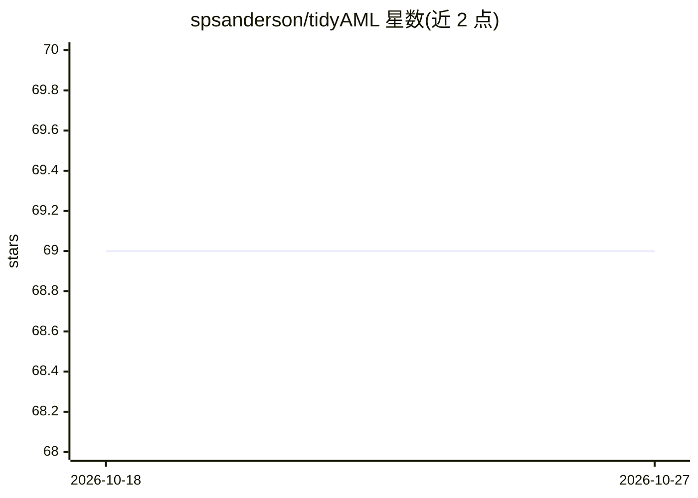

# spsanderson/tidyAML

⭐ 69 · R · NOASSERTION · 推送 2026-08-25 · [GitHub](https://github.com/spsanderson/tidyAML) · [官网](http://www.spsanderson.com/tidyAML/) · 个人维护

**R 语言的 AutoML 包：批量生成、训练并比较 tidymodels 模型**

tidyAML 是构建在 tidymodels 生态之上的 R 包，面向使用 tidyverse 工作流的数据分析者：通过 fast_regression() / fast_classification() 等函数一次生成并批量训练多个回归或分类模型规格，兼容 30+ parsnip 引擎；提供预测、残差、工作流对象提取函数及预测/残差绘图。训练基于 purrr::safely()，单个模型失败返回 NULL 而不中断流程。纯 R 实现、无 Java 依赖。生命周期徽章标注为 experimental。

## 筛选速览

| 维度 | 判定 | 备注 |
|---|---|---|
| AI 角色 | `ai-ecosystem` | LLM/agent 周边工具 |
| 许可风险 | `none` | NOASSERTION |
| 部署形态 | `None` |  |
| 模型依赖 | — | README 未给出锁定关系 |
| 硬件要求 | — | 无带数字的原话,不猜 |
| 安装摩擦 | `low` | 无编译、无系统依赖或容器化 |
| 成熟度 | `idea` | |

## 能力要点

- 单函数调用批量生成与训练多个回归/分类模型
- 兼容 30+ parsnip 引擎，纯 R 实现无需 Java
- purrr::safely() 容错：失败模型返回 NULL 不中断流程
- 提供预测/残差提取与可视化函数

## 适用场景

- 快速批量尝试多个回归或分类模型并比较结果
- 在 tidymodels/parsnip 工作流中自动生成模型规格
- 提取模型预测与残差做诊断分析

## 场景标签

`数据分析` · 领域:效率与自动化

## 证据(README 行号)

> L18: **`{tidyAML}`** is an R package that brings the power of Automated
> L19: Machine Learning (AutoML) to the `tidymodels` ecosystem. With just a few
> L26: - **🚀 Fast Model Generation**: Create multiple model specifications

## 星数曲线

2026-10-18 69 → 2026-10-27 69（+0）

---
*卡片 v1 · prompt 1.4 · 生成 2026-10-24 · 置信度 high · 依据 README sha `fc1d0410cec3` · [字段定义](../../DATASET.md)*
