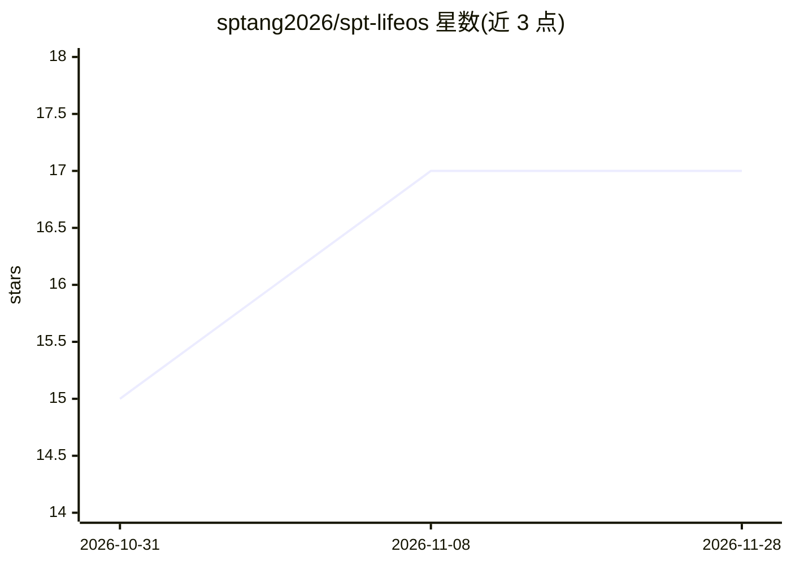

# sptang2026/spt-lifeos

⭐ 17 · MIT · 推送 2026-11-26 · [GitHub](https://github.com/sptang2026/spt-lifeos) · 个人维护 · 中文 README

**给个人创作者的多 Agent 第二大脑 Markdown 系统**

一套纯 Markdown 文件夹形态的个人知识管理系统：以五层架构（核心身份层/进化层/输入层/加工层/输出层）与 10 个分工 Agent 组织目录协议，把读书笔记、文章收藏与碎片灵感拆解为 QST/CON/OPI/CAS/SOL 五类 Wiki 原子单元，按需装配选题骨架与成稿，并通过 IDENTITY/MEMORY/进化系统文件沉淀个人风格。无数据库与编译依赖，需搭配能读写本地文件的 AI Agent 使用，含手动配置与 Agent 一键初始化两种启动方式。

## 筛选速览

| 维度 | 判定 | 备注 |
|---|---|---|
| AI 角色 | `ai-native` | 本体是模型或模型工具 |
| 许可风险 | `permissive` | MIT |
| 部署形态 | `None` |  |
| 模型依赖 | — | README 未给出锁定关系 |
| 硬件要求 | — | 无带数字的原话,不猜 |
| 安装摩擦 | `low` | 无编译、无系统依赖或容器化 |
| 成熟度 | — | 结构信号不足 |

## 能力要点

- 五层架构与 10 个 Agent 的目录协议（AGENT_LINKS/AGENTS.md）
- 知识拆解为 5 类原子单元并维护关系索引
- IDENTITY 文件自动加载使命、现状与风格画像
- 纯 Markdown 文件夹，Download ZIP 解压即用

## 适用场景

- 把读书笔记和收藏文章沉淀成可复用的选题素材库
- 让 AI 按我的表达风格装配选题骨架和成稿
- 用 Obsidian 浏览与管理双链知识库
- 把旧文章批量拆解回流为知识单元

## 场景标签

`知识库管理` `AI 写作` `多智能体` `提示工程` · 领域:Agent 开发

## 证据(README 行号)

> L9: **LifeOS** 是一套开源的 **AI 原生个人第二大脑（AI Second Brain / PKM）操作系统**。通过「核心身份层 + 进化层 + 输入层 + 加工层 + 输出层」五层架构与 10 个分工明确的 Agent，
> L109: 因为底层 100% 基于纯文本 Markdown 文件，本仓库天然兼容 **Obsidian**（作为可视化浏览与双链管理界面），并可直接搭配 **Claude Code、Google Antigravity、OpenAI Co

## 星数曲线

2026-10-31 15 → 2026-11-28 17（+2）

---
*卡片 v1 · prompt 1.4 · 生成 2026-11-27 · 置信度 high · 依据 README sha `58797bc9f734` · [字段定义](../../DATASET.md)*
