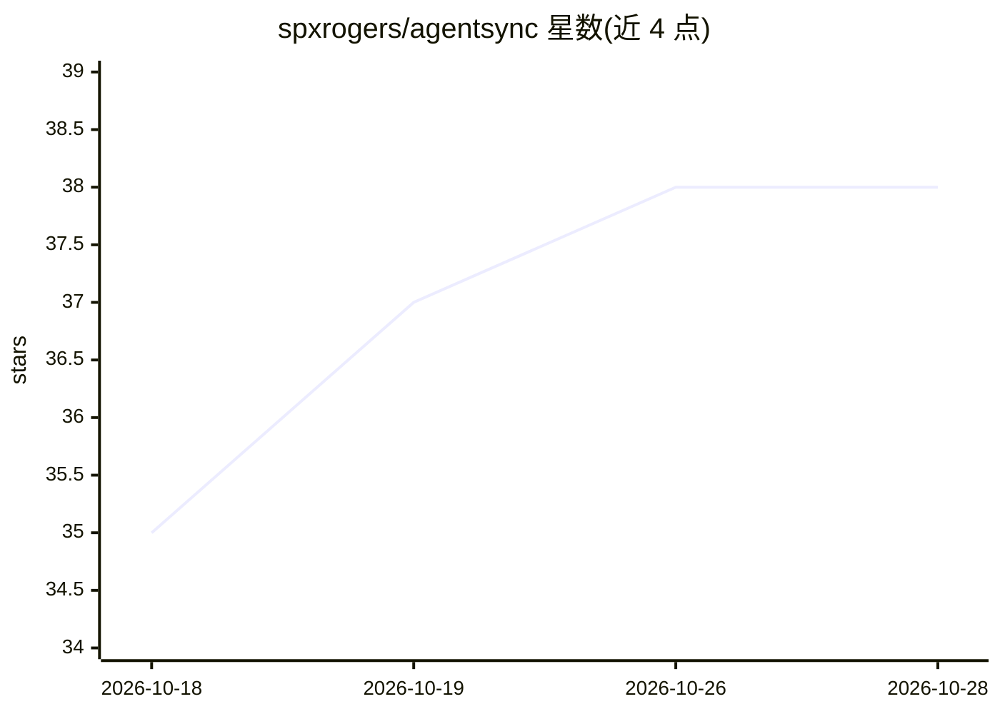

# spxrogers/agentsync

⭐ 38 · Go · MIT · 推送 2026-10-14 · [GitHub](https://github.com/spxrogers/agentsync) · [官网](https://agentsync.cc) · 个人维护

**AI 编码代理配置同步 CLI：一处定义，32 个代理生效**

Go 编写的命令行工具，将 MCP 服务器、memory、skills、插件等配置集中定义在 ~/.agentsync/ 目录并纳入版本管理，通过 agentsync apply 翻译投射到 32 个 AI 编码代理的原生配置：10 个深度适配器（Claude Code、OpenCode、Codex CLI、Cursor、Gemini CLI 等）+ 22 个通用适配代理。支持 chezmoi 式双向漂移检测与合并、age 加密的密钥引用（明文不回写）、apply 前 git 检查点与 revert。部分投射有损但均写入翻译报告。目前 beta（v0.1.0），CLI 与 schema 可能变动。

## 筛选速览

| 维度 | 判定 | 备注 |
|---|---|---|
| AI 角色 | `ai-ecosystem` | LLM/agent 周边工具 |
| 许可风险 | `permissive` | MIT |
| 部署形态 | `desktop` | 安装包/桌面程序 |
| 模型依赖 | locked-api |  |
| 硬件要求 | — | 无带数字的原话,不猜 |
| 安装摩擦 | `low` | 无编译、无系统依赖或容器化 |
| 成熟度 | `idea` | |

## 能力要点

- 单一源配置投射到 32 个 AI 编码代理（10 深度适配 + 22 通用适配）
- 双向漂移检测与合并，不做静默覆盖
- age 加密密钥库，密文源可提交，diff 输出自动脱敏
- apply 前本地 git 检查点，支持 revert 回滚

## 适用场景

- 同时在多个 AI 编码代理间保持 MCP/skills/命令配置一致
- 把代理配置纳入 dotfiles 做跨机器同步
- 在 CI 中用 status --exit-code 检测配置漂移

## 场景标签

 · 领域:开发者工具/AI 代理配置管理

## 证据(README 行号)

> L5: Define your MCP servers, memory, skills, and marketplace plugins once in
> L6: `~/.agentsync/`. Run `agentsync apply`. They land — correctly translated — in
> L7: **32 agents**: ten deep adapters (Claude Code, OpenCode, Codex CLI, Cursor,

## 星数曲线

2026-10-18 35 → 2026-10-28 38（+3）

---
*卡片 v1 · prompt 1.4 · 生成 2026-10-25 · 置信度 mid · 依据 README sha `f1fab1eca4fc` · [字段定义](../../DATASET.md)*
