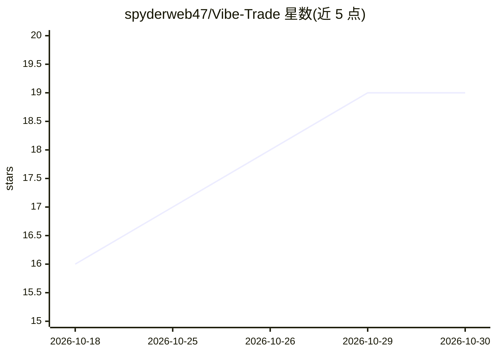

# spyderweb47/Vibe-Trade

⭐ 19 · TypeScript · 推送 2026-04-22 · [GitHub](https://github.com/spyderweb47/Vibe-Trade) · [官网](https://trading-pattern-ai.vercel.app) · 个人维护

**带技能系统的对话式 AI 交易平台：图表分析、策略回测**

面向交易者的 AI 平台：单一默认 agent 接收自然语言请求，内置规划器分解多步工作流（拉取行情→形态检测→策略生成→回测），生成的 JavaScript 脚本在浏览器 Web Worker 中执行，输出权益曲线、交易列表与组合指标。技能以纯 SKILL.md 文件声明工具（中央目录 23 个工具，带能力型白名单安全）。数据来自 yfinance 与 ccxt（100+ 加密交易所），无需 API key。支持 9 家 LLM 提供商含本地 Ollama，附多 agent 委员会模拟与 Playground 模拟盘。pipx 一条命令安装，包内捆绑预构建 Next.js 前端，运行时无需 Node.js。

## 筛选速览

| 维度 | 判定 | 备注 |
|---|---|---|
| AI 角色 | `ai-native` | 本体是模型或模型工具 |
| 许可风险 | `none` | — |
| 部署形态 | `library` | 以包/库形式分发 |
| 模型依赖 | local-ok | 支持本地模型 |
| 硬件要求 | — | 无带数字的原话,不猜 |
| 安装摩擦 | `low` | 无编译、无系统依赖或容器化 |
| 成熟度 | — | 结构信号不足 |

## 能力要点

- 内置规划器在浏览器内执行多步工作流（数据→形态→策略→回测）
- 技能为纯 SKILL.md 声明，23 个中央工具目录带白名单安全
- yfinance/ccxt 拉取行情数据，无需数据 API key
- 9 家 LLM 提供商可选，含 100% 本地的 Ollama

## 适用场景

- 用一句自然语言完成行情拉取、形态检测与策略回测
- 通过 SKILL.md 扩展 agent 技能而不写前端代码
- 运行多 agent 委员会辩论生成资产共识观点
- 在 Playground 模式重放历史数据做杠杆模拟交易

## 场景标签

`金融量化` `多智能体` · 领域:Agent 开发

## 证据(README 行号)

> L5: Chart data → pattern detection → strategy generation → backtesting, all driven by a single conversational agent that
> L24: The agent plans a three-step workflow, fetches real market data from Binance, generates a detection script, runs it

## 星数曲线

2026-10-18 16 → 2026-10-30 19（+3）

---
*卡片 v1 · prompt 1.4 · 生成 2026-10-28 · 置信度 high · 依据 README sha `8735a4863d8c` · [字段定义](../../DATASET.md)*
