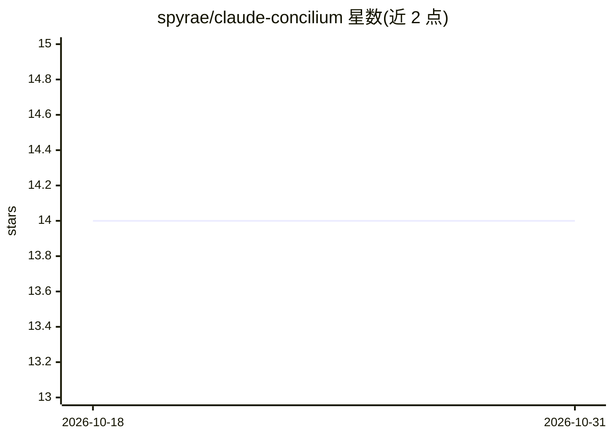

# spyrae/claude-concilium

⭐ 14 · JavaScript · MIT · 推送 2026-03-02 · [GitHub](https://github.com/spyrae/claude-concilium) · 个人维护

**让 Claude Code 通过 MCP 咨询多家 LLM 获取多方意见**

面向 Claude Code 用户的多 agent 会商框架：以多个 MCP server 包装 CLI 工具（codex/gemini-cli/qwen），并行向 OpenAI、Gemini、Qwen 等发起相同咨询，再综合共识或迭代解决分歧。提供回退链与配额/认证错误的结构化检测，每个 server 可独立使用或组成框架。安装为 clone 后 npm install 并配置 .mcp.json，也支持 Docker 运行；主要提供商走 OAuth，无需自备 API key（DeepSeek 除外）。需 Node.js 20+ 及对应 CLI 的本地认证。

## 筛选速览

| 维度 | 判定 | 备注 |
|---|---|---|
| AI 角色 | `ai-ecosystem` | LLM/agent 周边工具 |
| 许可风险 | `permissive` | MIT |
| 部署形态 | `self-host` | docker 或自建部署 |
| 模型依赖 | — | README 未给出锁定关系 |
| 硬件要求 | — | 无带数字的原话,不猜 |
| 安装摩擦 | `low` | 无编译、无系统依赖或容器化 |
| 成熟度 | — | 结构信号不足 |

## 能力要点

- 并行咨询 2+ AI agent 并综合共识
- 回退链与结构化错误检测（配额/认证/超时）
- 每个 MCP server 可独立使用（mcp-openai/mcp-gemini/mcp-qwen）
- Docker 运行支持与可自定义新增 provider

## 适用场景

- 代码评审或架构决策时获取多家 LLM 的第二意见
- 卡住的 bug 多角度会商
- 在配额耗尽时自动切换回退 provider

## 场景标签

`多智能体` `代码审查` · 领域:Agent 开发

## 证据(README 行号)

> L14: **Multi-agent AI consultation framework for Claude Code via MCP.**
> L31: Concilium runs parallel consultations with multiple LLMs through standard MCP protocol. Each LLM server wraps a CLI
> L36: - Each MCP server works standalone or as part of Concilium

## 星数曲线

2026-10-18 14 → 2026-10-31 14（+0）

---
*卡片 v1 · prompt 1.4 · 生成 2026-10-31 · 置信度 mid · 依据 README sha `c25cd7b0fa1e` · [字段定义](../../DATASET.md)*
