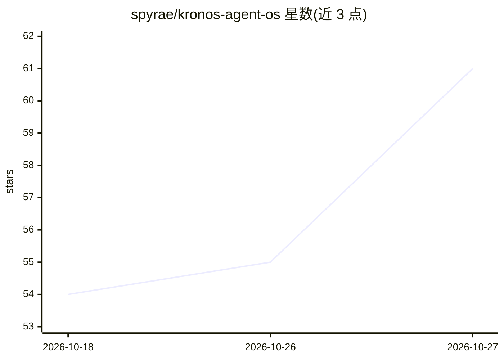

# spyrae/kronos-agent-os

⭐ 61 · Python · MIT · 推送 2026-10-22 · [GitHub](https://github.com/spyrae/kronos-agent-os) · [官网](https://github.com/spyrae/kronos-agent-os/tree/main/docs) · 个人维护

**自托管的持久 AI agent 运行时，含记忆/技能/MCP 工具/自动化**

KAOS 是本地优先的自托管 agent 运行层：提供自定义 ReAct 循环运行时，入口覆盖 CLI、Telegram、Discord、webhook 与 cron；记忆系统含会话历史、FTS5 召回、Mem0 向量、知识图谱与睡眠期整合；工具网关接入 MCP 工具、自定义工具与浏览器工具，并支持可选子 agent 的 swarm 协调（SQLite 仲裁）。默认安全姿态保守，动态工具/动态 MCP/SSH 操作默认禁用。LLM 通过 .env 配置，默认链为 DeepSeek，可切换 OpenAI/Ollama 等。提供 PyPI 安装、Docker Compose 与行为回放评测（kaos eval）。

## 筛选速览

| 维度 | 判定 | 备注 |
|---|---|---|
| AI 角色 | `ai-ecosystem` | LLM/agent 周边工具 |
| 许可风险 | `permissive` | MIT |
| 部署形态 | `self-host` | docker 或自建部署 |
| 模型依赖 | local-ok | 支持本地模型 |
| 硬件要求 | — | 无带数字的原话,不猜 |
| 安装摩擦 | `low` | 无编译、无系统依赖或容器化 |
| 成熟度 | — | 结构信号不足 |

## 能力要点

- 多入口运行时（CLI/Telegram/Discord/webhook/cron）与含向量/知识图谱的多层记忆
- MCP 工具网关与可选 swarm 多 agent 协调（SQLite 仲裁）
- agent 可导出/导入，支持从 ChatGPT/Claude/Obsidian 等历史迁移
- 默认保守的安全门控与哈希链审计日志

## 适用场景

- 自托管一个长期运行、带记忆的个人助理 agent
- 在 Telegram/Discord 群组中运行多 agent 协作面板
- 定时执行摘要、监控与竞品情报自动化任务

## 场景标签

`Agent 框架` `多智能体` `AI 助手` `工作流自动化` · 领域:Agent 开发

## 证据(README 行号)

> L9: Self-hosted runtime for durable AI agents that remember, use skills, call MCP tools, run scheduled work, and coordin
> L11: KAOS is an agent operating layer:
> L15: - **Runtime**: local agent loop with CLI, Telegram, Discord, webhook, and cron entry points.

## 星数曲线

2026-10-18 54 → 2026-10-27 61（+7）

---
*卡片 v1 · prompt 1.4 · 生成 2026-10-24 · 置信度 mid · 依据 README sha `ce0032f556d7` · [字段定义](../../DATASET.md)*
