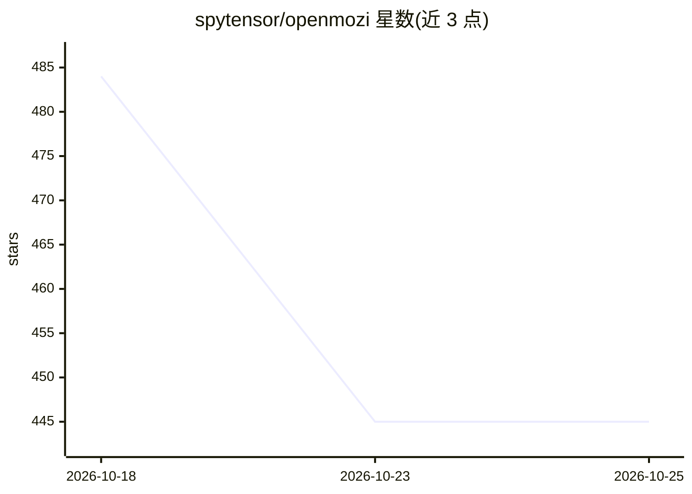

# spytensor/openmozi

⭐ 445 · TypeScript · MIT · 推送 2026-08-07 · [GitHub](https://github.com/spytensor/openmozi) · 个人维护 · 中文 README

**本地自托管的个人 AI Agent 桌面应用，执行任务交付文件**

桌面端 AI agent（自称 self-hosted Codex 式），指向项目文件夹后执行 shell 命令、文件编辑、网页检索与文档生成，交付文件均对照文件系统核验。提供 25 个内置技能、长期记忆、定时任务与权限分级。支持任意 OpenAI 兼容 API（目录含 27 家提供商，默认 MiniMax），也可配合 Ollama 全本地运行。桌面版仅提供 Apple Silicon DMG（未签名），服务器模式支持 Linux x64/arm64；技术栈为 TypeScript/Electron/Fastify。

## 筛选速览

| 维度 | 判定 | 备注 |
|---|---|---|
| AI 角色 | `ai-native` | 本体是模型或模型工具 |
| 许可风险 | `permissive` | MIT |
| 部署形态 | `self-host` | docker 或自建部署 |
| 模型依赖 | local-ok | 支持本地模型 |
| 硬件要求 | — | 无带数字的原话,不猜 |
| 安装摩擦 | `low` | 无编译、无系统依赖或容器化 |
| 成熟度 | — | 结构信号不足 |

## 能力要点

- 执行 shell/文件编辑/检索并核验交付文件真实性
- 25 个内置技能 + SKILL.md 自定义技能加载
- 长期记忆与定时/循环任务
- 27 家 OpenAI 兼容提供商，支持 Ollama 全本地运行

## 适用场景

- 在本机让 agent 按分支完成编码任务并跑测试
- 生成并预览 Word/PPT/Excel/PDF 文档（支持 CJK）
- 定时自动执行重复任务，跨会话记住偏好
- 用 Ollama 做全本地私有的个人助手

## 场景标签

`AI 助手` `编码 Agent` · 领域:编码与开发

## 证据(README 行号)

> L14: MOZI is a desktop AI agent (think of a personal, self-hosted Codex) that runs entirely on your machine. You point i
> L9:  A personal AI agent that lives on your machine.
> L59: On first launch, create your local account and add an LLM API key. The app manages its own backend and data — no se

## 星数曲线

2026-10-18 484 → 2026-10-25 445（-39）

---
*卡片 v1 · prompt 1.4 · 生成 2026-10-21 · 置信度 mid · 依据 README sha `580f4f35d957` · [字段定义](../../DATASET.md)*
