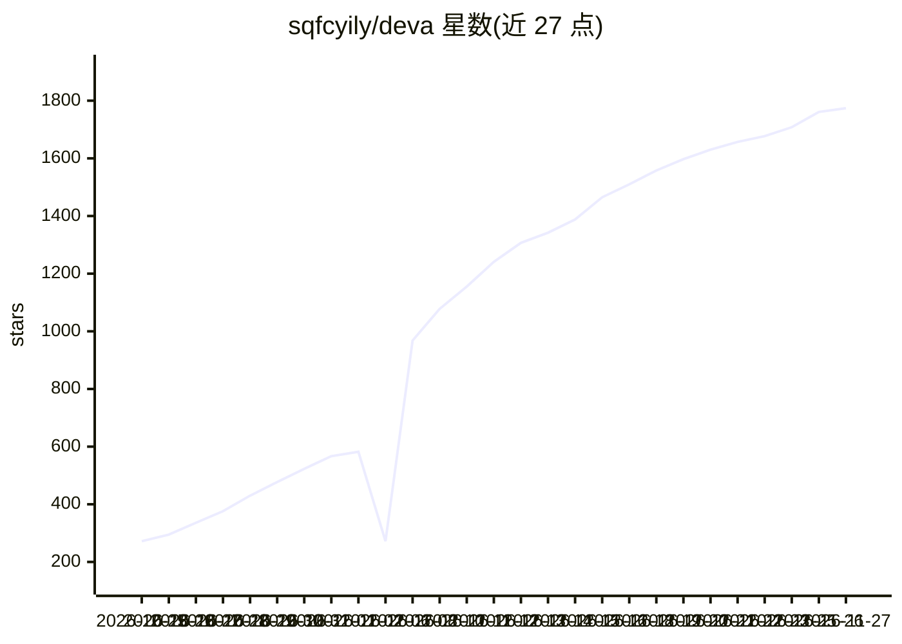

# sqfcyily/deva

⭐ 1,774 · TypeScript · MIT · 推送 2026-11-25 · [GitHub](https://github.com/sqfcyily/deva) · [官网](https://deva.chat) · 个人维护 · 中文 README

**对话入口的本机 AI Agent，多角色协作完成调研到交付**

Electron 桌面 AI Agent 应用，以对话为唯一入口：交代目标后由角色完成调研、执行到交付，可在同一对话中按需添加成员并行分工，成员各自绑定目录与模型。支持工作区挂载、AGENTS.md 项目约定、SKILL.md 技能、MCP 服务、定时任务、检查点回退与本地记忆，数据保存在本机 ~/.deva。面向需要用对话完成编程、写作、数据分析与安全研究任务的个人用户。限制：不设授权弹框，文件读写与命令执行由模型直接执行，需在版本控制下使用。

## 筛选速览

| 维度 | 判定 | 备注 |
|---|---|---|
| AI 角色 | `ai-native` | 本体是模型或模型工具 |
| 许可风险 | `permissive` | MIT |
| 部署形态 | `desktop` | 安装包/桌面程序 |
| 模型依赖 | local-ok | 支持本地模型 |
| 硬件要求 | — | 无带数字的原话,不猜 |
| 安装摩擦 | `low` | 无编译、无系统依赖或容器化 |
| 成熟度 | — | 结构信号不足 |

## 能力要点

- 多成员协作：主角色按需派发任务，成员在独立会话中并行工作并以本人身份回报
- 内置角色小码酱：面向国产模型的提示词攻防（破甲）与二进制逆向工作流
- SKILL.md 技能与 MCP（stdio/SSE/Streamable HTTP），支持飞书/Telegram 远程接入同一会话
- 数据全本地保存，密钥经系统 safeStorage 加密，支持 /rewind 检查点回退

## 适用场景

- 在对话里交代一个目标，让 Agent 自主完成调研、编码到交付
- 前后端分属不同仓库时，让多个成员各自挂载目录并行开发
- 对国产模型做提示词注入与越狱攻防研究、本地软件样本逆向分析
- 通过飞书或 Telegram 在手机上继续电脑上的同一会话

## 场景标签

`AI 助手` `编码 Agent` `网络安全` `数据分析` · 领域:效率与自动化

## 证据(README 行号)

> L19: Deva 是运行在本机的桌面 AI Agent，以对话为唯一入口。交代一个目标，角色即可从调研、动手到交付独立完成；工作需要分工时，主角色在当前对话中添加成员并行处理，完成后汇总交付。角色、定时任务、技能、MCP 服务与工作区挂载
> L55: |多角色对话|每个对话绑定一个角色，角色定义身份、语气与偏好模型；支持表单创建与对话式创建|
> L145: |Deva|默认角色。通用工作助手，覆盖编程、写作、资料整理、数据分析与命令执行|

## 星数曲线

2026-10-25 272 → 2026-11-27 1,774（+1,502）

---
*卡片 v1 · prompt 1.4 · 生成 2026-11-26 · 置信度 mid · 依据 README sha `63f7a774579f` · [字段定义](../../DATASET.md)*
