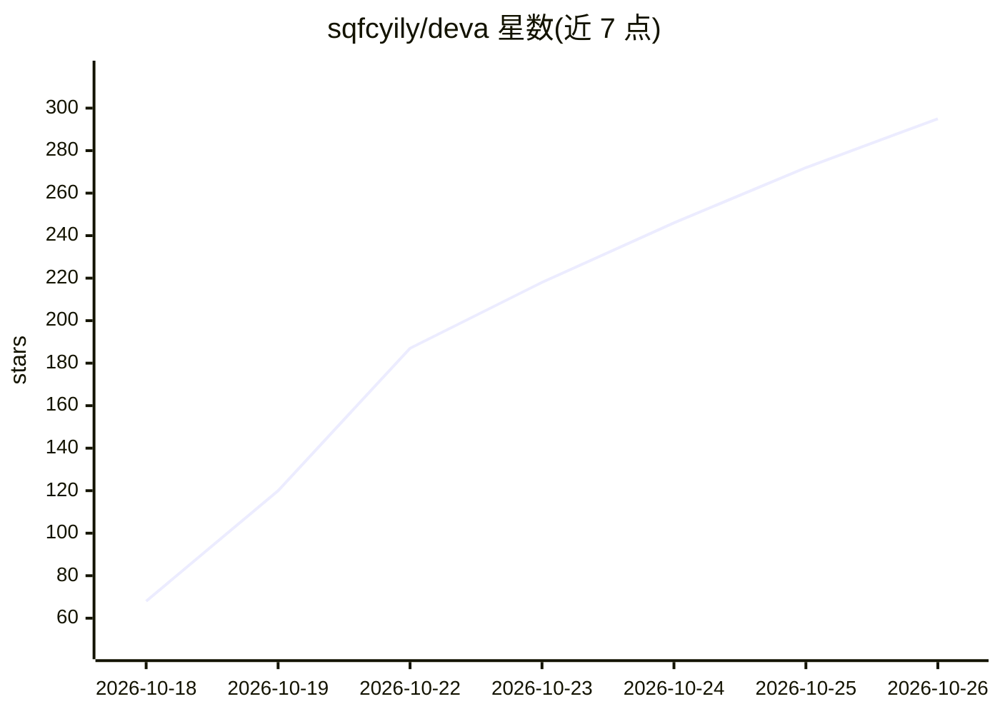

# sqfcyily/deva

⭐ 295 · TypeScript · MIT · 推送 2026-10-25 · [GitHub](https://github.com/sqfcyily/deva) · [官网](https://sqfcyily.github.io/deva/) · 个人维护 · 中文 README

**对话式桌面 AI 助手：把 Agent 能力装进聊天里**

基于 Electron 的桌面对话式 AI 助手，功能在对话中完成：挂载文件夹后可读代码、改文件、运行命令；大任务自动拆给多个子智能体并行执行，各自独立上下文只交回结论；支持定时任务（cron 等）、/rewind 代码与对话回退、用户习惯记忆、Git 快捷操作、技能与 MCP 接入、长对话自动压缩。已预置 Anthropic、OpenAI、Gemini、DeepSeek、Kimi、智谱 GLM、通义千问、Ollama 等服务商，可添加 OpenAI 兼容接口。通过飞书、Telegram 机器人在手机上继续对话。提供 Windows/macOS 安装包，也可从源码运行。注意：动手执行前不弹授权框。

## 筛选速览

| 维度 | 判定 | 备注 |
|---|---|---|
| AI 角色 | `ai-native` | 本体是模型或模型工具 |
| 许可风险 | `permissive` | MIT |
| 部署形态 | `desktop` | 安装包/桌面程序 |
| 模型依赖 | local-ok | 支持本地模型 |
| 硬件要求 | — | 无带数字的原话,不猜 |
| 安装摩擦 | `low` | 无编译、无系统依赖或容器化 |
| 成熟度 | — | 结构信号不足 |

## 能力要点

- 多角色对话与四类子智能体（通用/检索/调研/方案）并行派发
- 挂载文件夹后可读写文件、执行命令，计划需用户批准后执行
- 定时任务支持每天/每周/每月/cron，仅应用运行时执行
- 飞书、Telegram 机器人接入，手机上延续电脑端对话
- 用户 API 密钥配置后自选服务商与模型，数据存于本机 ~/.deva

## 适用场景

- 像聊天一样让 AI 帮我改项目代码、跑命令
- 设定每天自动整理提交生成日报的定时任务
- 出门在外用手机通过 Telegram/飞书继续指挥电脑上的任务
- 建多个不同性格和常用模型的角色获得不同视角回答

## 场景标签

`AI 助手` `编码 Agent` · 领域:编码与开发

## 证据(README 行号)

> L9: 把 Agent 能力装进对话里，无需复杂配置，像聊天一样使用 Agent。
> L28:  🗣️ All in Chat
> L49: 2. 打开 **设置 → 模型**，选一个服务商，填上 API 密钥，把要用的模型加进来

## 星数曲线

2026-10-18 68 → 2026-10-26 295（+227）

---
*卡片 v1 · prompt 1.4 · 生成 2026-10-22 · 置信度 mid · 依据 README sha `305331fcefd6` · [字段定义](../../DATASET.md)*
