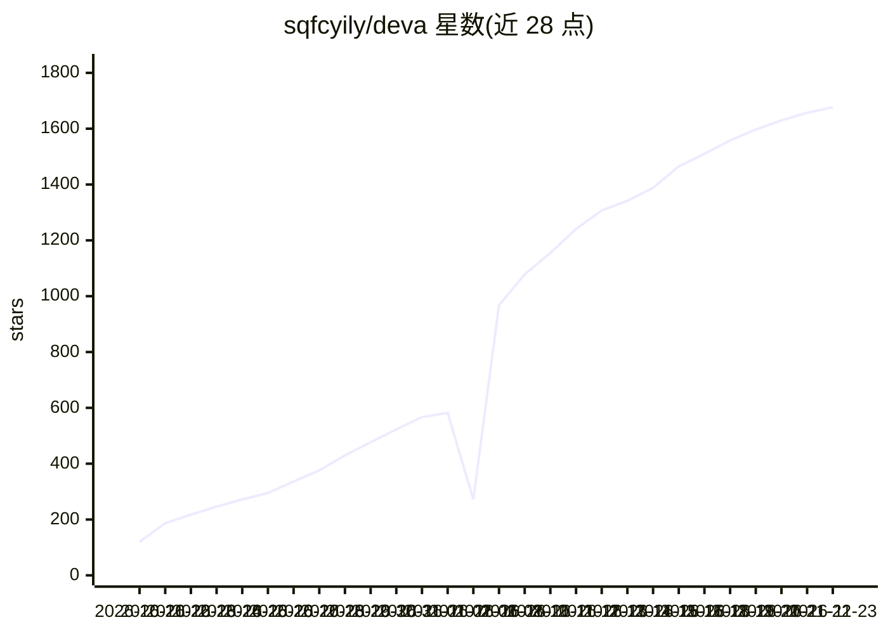

# sqfcyily/deva

⭐ 1,677 · TypeScript · MIT · 推送 2026-11-21 · [GitHub](https://github.com/sqfcyily/deva) · [官网](https://deva.chat) · 个人维护 · 中文 README

**本地桌面对话式 AI Agent：多角色协作与多成员分工**

基于 Electron 的本机桌面 AI Agent，以对话为唯一入口：交代目标后由角色完成调研、执行与交付。主角色可按需添加成员（每对话最多 10 位）在独立会话中并行分工，另有 General/Explore/Research/Plan/fork 五类子智能体。支持工作区挂载与 AGENTS.md 项目约定、SKILL.md 技能、MCP（stdio/SSE/Streamable HTTP）、记忆、定时任务与 /rewind 检查点；数据保存在本机 ~/.deva。不设授权弹框，文件读写与命令执行由模型直接执行，README 建议在版本控制下使用。

## 筛选速览

| 维度 | 判定 | 备注 |
|---|---|---|
| AI 角色 | `ai-native` | 本体是模型或模型工具 |
| 许可风险 | `permissive` | MIT |
| 部署形态 | `desktop` | 安装包/桌面程序 |
| 模型依赖 | local-ok | 支持本地模型 |
| 硬件要求 | — | 无带数字的原话,不猜 |
| 安装摩擦 | `low` | 无编译、无系统依赖或容器化 |
| 成熟度 | — | 结构信号不足 |

## 能力要点

- 多成员协作：主角色按需组队，成员独立会话并行工作并以本人身份回报
- 定时任务无人值守执行，含原地打转检测与 100 步循环保护
- 支持 SKILL.md 技能与 MCP 服务，可经飞书/Telegram 机器人远程续会话
- 内置浏览器与文件读写、shell 执行、Git 操作等工具集

## 适用场景

- 在一个对话里让多个角色分工完成前后端协作开发
- 通过定时任务无人值守执行周期性工作
- 手机上经飞书或 Telegram 机器人继续桌面会话
- 挂载本地项目目录做代码修改与交付

## 场景标签

`AI 助手` `多智能体` `编码 Agent` · 领域:Agent 开发

## 证据(README 行号)

> L17: Deva 是运行在本机的桌面 AI Agent，以对话为唯一入口。交代一个目标，角色即可从调研、动手到交付独立完成；工作需要分工时，主角色在当前对话中添加成员并行处理，完成后汇总交付。角色、定时任务、技能、MCP 服务与工作区挂载
> L23: 内置角色「小码酱」，针对国产模型（DeepSeek、Kimi、智谱 GLM、通义千问等）调校，无需安装 skill 或 MCP，选定角色即可使用。两项核心能力：
> L64: |远程访问|通过飞书 / Lark、Telegram 机器人在手机上继续同一会话|

## 星数曲线

2026-10-21 120 → 2026-11-23 1,677（+1,557）

---
*卡片 v1 · prompt 1.4 · 生成 2026-11-23 · 置信度 mid · 依据 README sha `c374859e242c` · [字段定义](../../DATASET.md)*
