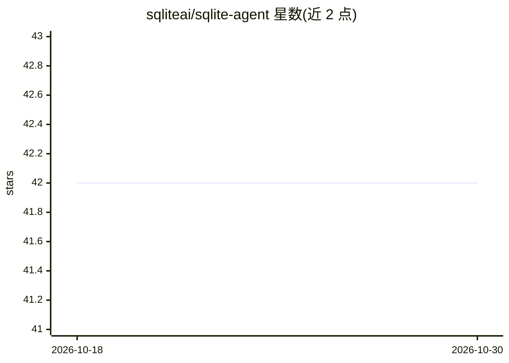

# sqliteai/sqlite-agent

⭐ 42 · C · Apache-2.0 · 推送 2026-10-20 · [GitHub](https://github.com/sqliteai/sqlite-agent) · [官网](https://sqlite.ai) · 组织维护

**让 SQLite 数据库内运行自主 AI agent 的 SQLite 扩展**

跨平台 SQLite 扩展，通过 SQL 定义自主 AI agent：agent 接收目标与 MCP 工具，迭代决定调用哪个工具、经 sqlite-mcp 执行、循环直至达成目标或达到最大迭代次数，可自动抓取外部数据并填充数据库表。LLM 推理与嵌入依赖 sqlite-ai，可选 sqlite-vector 自动生成嵌入与向量索引。提供 Linux/macOS/Windows/Android/iOS 预编译二进制，以及 Swift/Gradle/Flutter(Dart) 包安装方式，无需编排服务器。

## 筛选速览

| 维度 | 判定 | 备注 |
|---|---|---|
| AI 角色 | `ai-ecosystem` | LLM/agent 周边工具 |
| 许可风险 | `permissive` | Apache-2.0 |
| 部署形态 | `desktop` | 安装包/桌面程序 |
| 模型依赖 | — | README 未给出锁定关系 |
| 硬件要求 | — | 无带数字的原话,不猜 |
| 安装摩擦 | `low` | 无编译、无系统依赖或容器化 |
| 成熟度 | — | 结构信号不足 |

## 能力要点

- SQL 中用 agent_run() 运行多步自主 agent
- 经 sqlite-mcp 调用外部工具（web/API）并自动填充表
- 依赖 sqlite-ai 做 LLM 推理与嵌入，sqlite-memory 提供记忆
- 支持 BLOB 列名 *_embedding 自动生成嵌入并建向量索引

## 适用场景

- 在 SQLite 内运行抓取外部数据并入库的自主 agent
- 本地/端上运行无需编排服务器的 agent
- 组合 MCP、AI、vector 扩展构建数据管道

## 场景标签

`Agent 框架` · 领域:Agent 开发

## 证据(README 行号)

> L30: **SQLite Agent** is a cross-platform SQLite extension that brings autonomous AI agents to your database. It enables
> L36: * **AI Powered** – Uses sqlite-ai for LLM inference and embeddings

## 星数曲线

2026-10-18 42 → 2026-10-30 42（+0）

---
*卡片 v1 · prompt 1.4 · 生成 2026-10-25 · 置信度 high · 依据 README sha `7c004b972e7e` · [字段定义](../../DATASET.md)*
