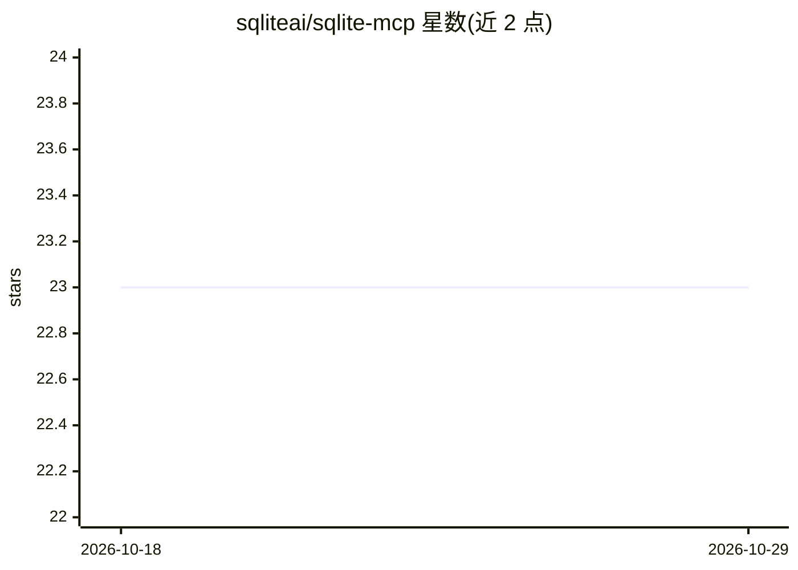

# sqliteai/sqlite-mcp

⭐ 23 · C · Apache-2.0 · 推送 2026-10-20 · [GitHub](https://github.com/sqliteai/sqlite-mcp) · [官网](https://sqlite.ai) · 组织维护

**SQLite 扩展：在 SQL 中连接 MCP 服务器并调用其工具**

基于 MCP Rust SDK 的 SQLite 扩展，使 SQLite 数据库可作为 MCP 客户端：通过 mcp_connect 连接任意 MCP 服务器，用 SQL 函数与虚拟表列出及调用工具，支持 Streamable HTTP 与 SSE（兼容旧服务器）两种传输协议。提供 macOS/Linux/Windows/Android/iOS 预编译二进制及 Flutter/Dart 包，也可用 Rust 1.85+ 与 C 编译器从源码构建。属于 SQLite AI 生态的一环，另有 SQLite Cloud 托管版提供内建 MCP 服务器。

## 筛选速览

| 维度 | 判定 | 备注 |
|---|---|---|
| AI 角色 | `ai-ecosystem` | LLM/agent 周边工具 |
| 许可风险 | `permissive` | Apache-2.0 |
| 部署形态 | `None` |  |
| 模型依赖 | — | README 未给出锁定关系 |
| 硬件要求 | — | 无带数字的原话,不猜 |
| 安装摩擦 | `medium` | 含编译或系统依赖之一 |
| 成熟度 | — | 结构信号不足 |

## 能力要点

- mcp_connect / mcp_call_tool 等 SQL 函数与虚拟表 API
- 支持 Streamable HTTP（默认）与 SSE 两种传输协议
- 覆盖 macOS/Linux/Windows/Android/iOS 的预编译二进制与 Flutter/Dart 包
- 与 SQLite AI 生态（sqlite-vector/sqlite-agent/sqlite-memory 等）配套

## 适用场景

- 在 SQL 查询内直接调用 MCP 服务器的工具
- 让数据库侧集成 agent 工具生态
- Flutter/Dart 应用内嵌 MCP 客户端能力

## 场景标签

 · 领域:数据库/AI 基础设施

## 证据(README 行号)

> L30: A SQLite extension that integrates the Model Context Protocol (MCP) Rust SDK, enabling SQLite databases to connect 
> L79: |`mcp_call_tool_json(name, args)`|Call a tool on the MCP server|

## 星数曲线

2026-10-18 23 → 2026-10-29 23（+0）

---
*卡片 v1 · prompt 1.4 · 生成 2026-10-27 · 置信度 high · 依据 README sha `78499d442003` · [字段定义](../../DATASET.md)*
