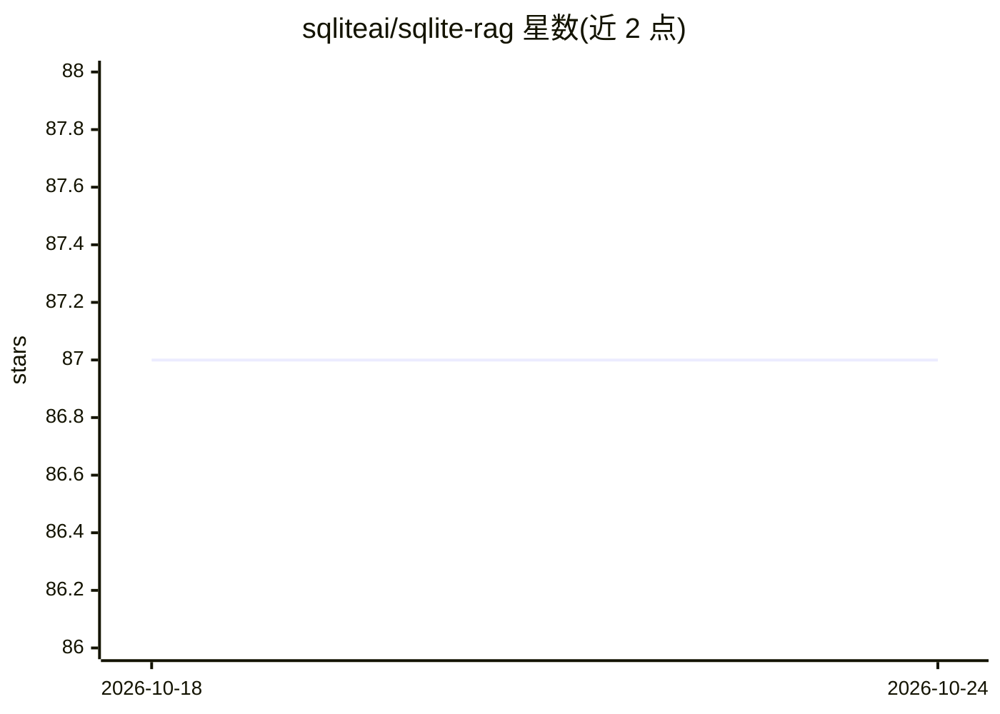

# sqliteai/sqlite-rag

⭐ 87 · Python · 推送 2025-11-18 · [GitHub](https://github.com/sqliteai/sqlite-rag) · [官网](https://sqlite.ai) · 组织维护

**基于 SQLite 的混合检索引擎：向量搜索+全文检索做文档 RAG**

构建于 SQLite 之上的混合搜索引擎，借助 SQLite AI 与 SQLite Vector 扩展，将向量相似度检索与 FTS5 全文检索结合，用 Reciprocal Rank Fusion 融合结果。支持处理 PDF/DOCX/Markdown/代码等多格式文件，内置 token 感知的递归文本分块。默认预配置使用 Embedding Gemma 模型（GGUF，可从 Hugging Face 下载替换），提供 CLI 与交互式 REPL。要求 SQLite 支持扩展加载。以 Python 包形式通过 pip 安装。

## 筛选速览

| 维度 | 判定 | 备注 |
|---|---|---|
| AI 角色 | `ai-ecosystem` | LLM/agent 周边工具 |
| 许可风险 | `none` | — |
| 部署形态 | `library` | 以包/库形式分发 |
| 模型依赖 | local-ok | 支持本地模型 |
| 硬件要求 | — | 无带数字的原话,不猜 |
| 安装摩擦 | `low` | 无编译、无系统依赖或容器化 |
| 成熟度 | — | 结构信号不足 |

## 能力要点

- 向量相似度搜索与 FTS5 全文检索的混合检索，RRF 融合结果
- 默认预配置 Embedding Gemma 模型，添加文档即自动建库
- 支持 PDF/DOCX/PPTX/XLSX、Markdown、30 余种代码文件格式
- 交互式 CLI 与 REPL 模式，可配置嵌入模型、搜索权重与分块参数

## 适用场景

- 为本地文档库搭建无需外部服务的混合检索
- 在 SQLite 数据库中实现向量+全文的文档检索
- 实验不同 Hugging Face GGUF 嵌入模型对检索效果的影响

## 场景标签

`RAG` · 领域:知识与检索

## 证据(README 行号)

> L10: A hybrid search engine built on SQLite with SQLite AI and SQLite Vector extensions.
> L11: SQLite RAG combines vector similarity search with full-text search (FTS5 extension) using Reciprocal Rank Fusion (R

## 星数曲线

2026-10-18 87 → 2026-10-24 87（+0）

---
*卡片 v1 · prompt 1.4 · 生成 2026-10-23 · 置信度 high · 依据 README sha `524729e7edd6` · [字段定义](../../DATASET.md)*
