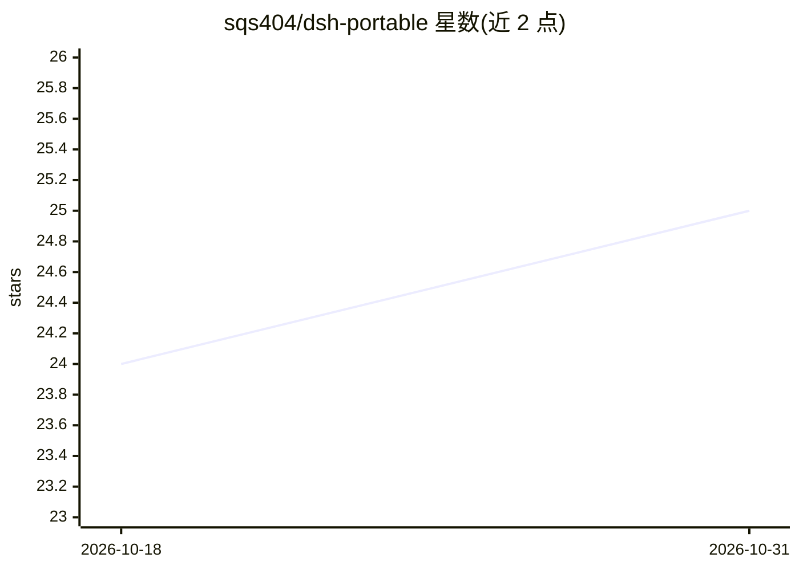

# sqs404/dsh-portable

⭐ 25 · PowerShell · MIT · 推送 2026-10-03 · [GitHub](https://github.com/sqs404/dsh-portable) · 个人维护 · 中文 README

**DeepSeek Harness 的 Windows 免安装便携版构建工程**

对官方 npm 包 @deepseek-ai/dsh 做 Windows 便携分发的封装工程：用 PowerShell 一键构建，自动下载官方 Node.js（v24.19.0）、扁平安装 dsh 0.2.0-rc.2、用系统自带 csc 编译 C# 启动器，组装出解压即用的目录。启动器通过 DSH_HOME 把用户数据指向 data\ 目录实现数据隔离，默认端口 3081，Web 界面启用一次性 token 鉴权。仅支持 64 位 Windows 10/11；官方标注 dsh 为开发者预览版，可能存在破坏性变更。本工程非官方制品。

## 筛选速览

| 维度 | 判定 | 备注 |
|---|---|---|
| AI 角色 | `ai-ecosystem` | LLM/agent 周边工具 |
| 许可风险 | `permissive` | MIT |
| 部署形态 | `desktop` | 安装包/桌面程序 |
| 模型依赖 | — | README 未给出锁定关系 |
| 硬件要求 | — | 无带数字的原话,不猜 |
| 安装摩擦 | `low` | 无编译、无系统依赖或容器化 |
| 成熟度 | `idea` | |

## 能力要点

- 内置 Node.js 与全部程序包，解压后双击启动器即用
- npm 扁平安装（零 junction/symlink），拷贝到任意目录不产生损坏链接
- 启动器以 DSH_HOME 隔离用户数据，不读写系统用户目录
- 支持 npmmirror 国内镜像加速构建

## 适用场景

- 在无开发环境的 Windows 电脑上免安装运行 DeepSeek Harness
- 把 dsh 拷贝到 U 盘/多台电脑上独立运行
- 国内网络环境下加速构建下载

## 场景标签

 · 领域:开发工具/软件分发

## 证据(README 行号)

> L3: DeepSeek Harness 的 Windows 免安装便携版：内置官方 Node.js 与全部程序包，解压后双击启动器即可使用，无需安装任何软件。
> L49: 2. 用 npm **扁平安装**官方发布包 `@deepseek-ai/dsh@0.2.0-rc.2`（`--ignore-scripts`，产物为纯真实目录、零链接）；
> L86: - 本工程为官方 npm 发布包的 Windows 分发封装，非官方制品；许可证 MIT（见 `LICENSE` 与 `THIRD_PARTY_NOTICES.md`），版权归 DeepSeek AI 及其贡献者所有。

## 星数曲线

2026-10-18 24 → 2026-10-31 25（+1）

---
*卡片 v1 · prompt 1.4 · 生成 2026-10-27 · 置信度 high · 依据 README sha `b105ee74558c` · [字段定义](../../DATASET.md)*
