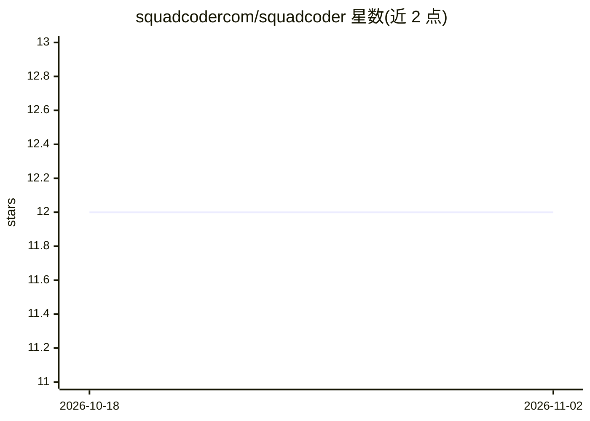

# squadcodercom/squadcoder

⭐ 12 · TypeScript · MIT · 推送 2026-06-29 · [GitHub](https://github.com/squadcodercom/squadcoder) · [官网](https://squadcoder.com) · 组织维护

**多智能体并行协作的 AI 编程助手（桌面/CLI）**

基于 opencode（MiMoCode 分支）构建的开源 AI 编程助手，以 Electron 桌面应用和 CLI 提供。核心 Team Mode 由编排者将需求拆分任务并派生 Architect/开发/QA/安全/UI 等专家智能体并行执行，经 CTO 质量门循环修复后交付。内置持久记忆、离线语义代码索引、100+ 技能、MCP 集成、远程 SSH 与定时任务；本地优先、MIT 许可，提供完整希伯来语 RTL 界面及 25+ 语言。需自带模型 API key（Anthropic/OpenRouter/任意 OpenAI 兼容端点）。

## 筛选速览

| 维度 | 判定 | 备注 |
|---|---|---|
| AI 角色 | `ai-native` | 本体是模型或模型工具 |
| 许可风险 | `permissive` | MIT |
| 部署形态 | `desktop` | 安装包/桌面程序 |
| 模型依赖 | locked-api |  |
| 硬件要求 | — | 无带数字的原话,不猜 |
| 安装摩擦 | `low` | 无编译、无系统依赖或容器化 |
| 成熟度 | — | 结构信号不足 |

## 能力要点

- Team Mode：编排者拆解任务，多专家智能体并行开发并经质量门验证
- 持久记忆与离线语义代码索引（捆绑模型，无云端依赖）
- 内置 100+ 技能与 MCP 原生集成（GitHub、Playwright 等）
- MIT 开源，本地优先，零配置启动

## 适用场景

- 让多个专家智能体并行完成一个完整功能或项目
- 在本地离线索引代码库并按语义检索
- 通过远程 SSH 在服务器上运行智能体处理代码

## 场景标签

`编码 Agent` `多智能体` · 领域:Agent 开发

## 证据(README 行号)

> L36: - An **orchestrator** breaks it into tasks and spins up the right specialists — _in parallel_.
> L96: 2. **Add a model** — bring your own API key (Anthropic, OpenRouter, or any OpenAI-compatible provider).

## 星数曲线

2026-10-18 12 → 2026-11-02 12（+0）

---
*卡片 v1 · prompt 1.4 · 生成 2026-11-01 · 置信度 high · 依据 README sha `96181de27423` · [字段定义](../../DATASET.md)*
