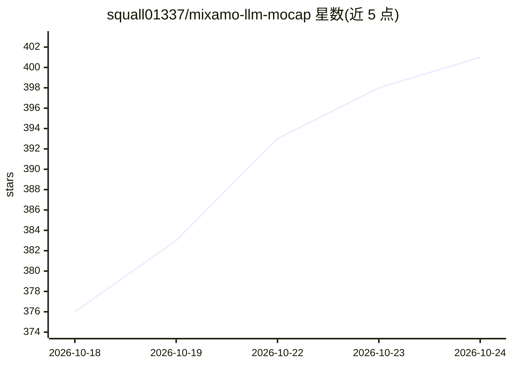

# squall01337/mixamo-llm-mocap

⭐ 403 · Python · NOASSERTION · 推送 2026-09-26 · [GitHub](https://github.com/squall01337/mixamo-llm-mocap) · 个人维护

**把固定机位视频转成 Mixamo 骨骼 FK 动画的动捕流水线**

视频转 Mixamo 角色动画的端到端流水线：GVHMR 估计 SMPL-X 关节旋转，基于 plate 自身关键点做 SMPLify 式拟合与手指检测，按 JSON action spec 完成重定向，经 Blender（后台运行或 MCP）生成 30fps FK 动画，并用 compare/eval 脚本按帧量化与源视频的偏差。支持双人同框按左右拆分轨道、双角色同场景布置与碰撞检查。各阶段均为 CLI 或 socket 调用，设计为可由 AI agent 全程操作。需自备 Mixamo FBX、Blender 5.1+、GVHMR 仓库与约 5GB 权重、SMPL-X 模型及约 8GB 显存的 GPU。

## 筛选速览

| 维度 | 判定 | 备注 |
|---|---|---|
| AI 角色 | `ai-native` | 本体是模型或模型工具 |
| 许可风险 | `none` | NOASSERTION |
| 部署形态 | `desktop` | 安装包/桌面程序 |
| 模型依赖 | — | README 未给出锁定关系 |
| 硬件要求 | `gpu-8g` | |
| 安装摩擦 | `medium` | 含编译或系统依赖之一 |
| 成熟度 | — | 结构信号不足 |

## 能力要点

- GVHMR → SMPL-X → FK 重定向流水线，输出 30fps Mixamo 动画
- 双人视频按画面左右拆分轨道并布置双角色场景
- compare_reference/compare_pair/eval_fidelity 按帧量化与源视频偏差
- 动作以 JSON spec 数据描述，各阶段为 CLI 或 socket 调用，可由 agent 操作

## 适用场景

- 把实拍或 AI 生成的打斗视频转成 Mixamo 角色动画
- 不用动捕服与手 K，产出可直接进 Mixamo 工作流的 FK 动画
- 让 AI agent 按 spec 与文档驱动整条动画生成循环

## 场景标签

 · 领域:图形/动画（视频动捕）

## 证据(README 行号)

> L3: **Turn any locked-camera video — filmed or AI-generated — into a clean
> L36:    ├─ 1. estimate_pose_gvhmr.py --smplx-only   GVHMR → SMPL-X parameters, refined on the plate's 2D keypoints (+ he
> L128: - **Written for agents.** Beat decisions come from

## 星数曲线

2026-10-18 376 → 2026-10-24 401（+25）

---
*卡片 v1 · prompt 1.4 · 生成 2026-10-21 · 置信度 high · 依据 README sha `c45f01fb3b6d` · [字段定义](../../DATASET.md)*
