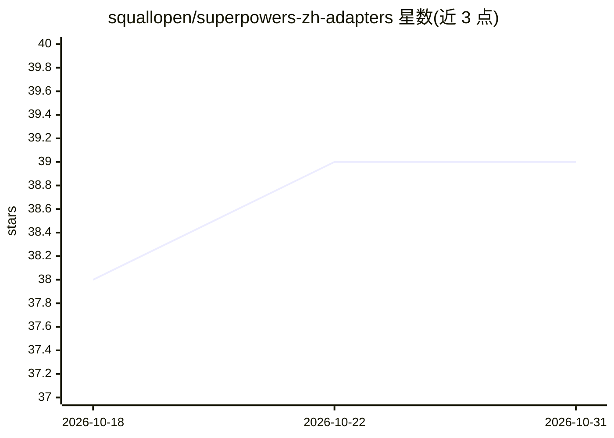

# squallopen/superpowers-zh-adapters

⭐ 39 · PowerShell · MIT · 推送 2026-10-24 · [GitHub](https://github.com/squallopen/superpowers-zh-adapters) · 个人维护 · 中文 README

**为 8 款编码 agent 接入 obra/superpowers 技能的中文适配层**

在 vendored 的 obra/superpowers v7.0.1（15 个上游 skill）之上补齐中文体验：中文触发词命中 skill、默认输出中文文件名与简体中文正文的计划/评审/设计文档，并把安装更新流程做成自动备份、只改专用说明段、不整文件覆盖的 PowerShell 脚本。适配 Cline、Claude Code、Codex、Droid、OpenCode、CodeBuddy、ZCode、Qoder CN 八款工具；官方脚本链路仅维护 Windows + PowerShell 7 + Git for Windows，不承诺 Linux/macOS。

## 筛选速览

| 维度 | 判定 | 备注 |
|---|---|---|
| AI 角色 | `ai-ecosystem` | LLM/agent 周边工具 |
| 许可风险 | `permissive` | MIT |
| 部署形态 | `None` |  |
| 模型依赖 | — | README 未给出锁定关系 |
| 硬件要求 | — | 无带数字的原话,不猜 |
| 安装摩擦 | `low` | 无编译、无系统依赖或容器化 |
| 成熟度 | — | 结构信号不足 |

## 能力要点

- 8 款编码 agent 工具的 skill 目录适配安装（User/Project 两种范围）
- 中文触发词与中文文档输出，上游英文 SKILL.md 保留
- 自动备份后安装，只更新专用说明段不整文件覆盖
- Codex 场景对 worktree/branch/push/PR 加硬限制，不假装成功

## 适用场景

- 在 Cline/Claude Code 等工具里用中文触发 superpowers 的计划、评审、TDD skill
- 生成中文命名的需求分析、总体设计、接口设计等文档
- 让其他 AI agent 按 docs/ai-agent-install.md 代为安装维护

## 场景标签

 · 领域:开发工具/AI agent 技能

## 证据(README 行号)

> L3: 把 `obra/superpowers` 接到 `Cline`、`Claude Code`、`Codex`、`Droid`、`OpenCode`、`CodeBuddy`、`ZCode`、`Qoder CN`，补上中文触发、中文文档输
> L25: - 15 个上游 skill 仍然保留，核心做法还是以上游英文 `SKILL.md` 为准
> L121: pwsh .\scripts\powershell\install-all.ps1 -Targets All -Scope User

## 星数曲线

2026-10-18 38 → 2026-10-31 39（+1）

---
*卡片 v1 · prompt 1.4 · 生成 2026-10-25 · 置信度 high · 依据 README sha `a791a7f814ef` · [字段定义](../../DATASET.md)*
