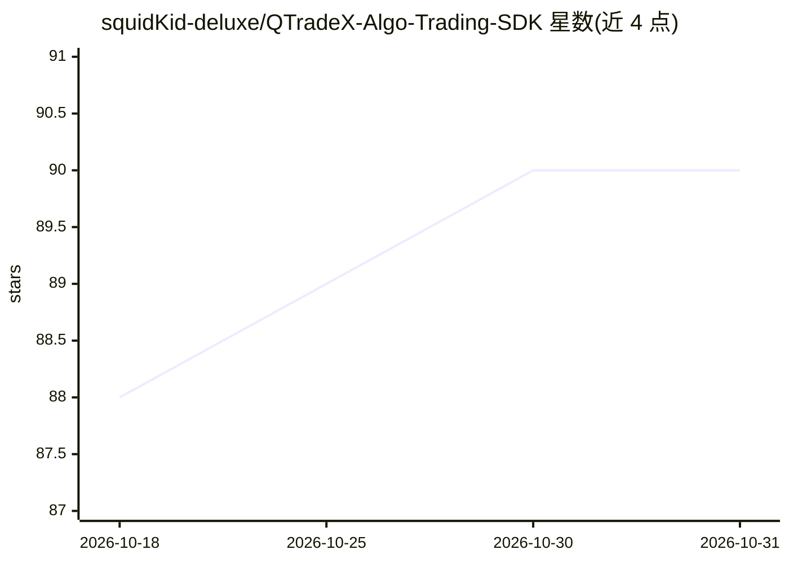

# squidKid-deluxe/QTradeX-Algo-Trading-SDK

⭐ 90 · Python · NOASSERTION · 推送 2026-07-30 · [GitHub](https://github.com/squidKid-deluxe/QTradeX-Algo-Trading-SDK) · [官网](https://qtradex.litepresence.com) · 个人维护

**加密货币量化交易框架：设计、回测与优化交易机器人**

面向加密市场的 Python 算法交易框架：通过继承 BaseBot 编写策略，用 CLI 或实时编码方式回测，借助 QPSO、LSGA 等优化算法调参（AI 驱动优化），并将参数按 bot 存储于 tunes/ 目录。数据侧经 CCXT 接入 100+ 中心化/去中心化交易所，另支持 DexPaprika 链上 DEX 池回测（36 条链，无需 API key）。指标层封装 Tulip 指标，作者报告在 Ryzen 5600x 上每秒可跑 200+ 次三年日线回测。以 pip 包与源码两种方式安装。

## 筛选速览

| 维度 | 判定 | 备注 |
|---|---|---|
| AI 角色 | `ai-enhanced` | 去掉 AI 部分产品仍成立 |
| 许可风险 | `none` | NOASSERTION |
| 部署形态 | `library` | 以包/库形式分发 |
| 模型依赖 | — | README 未给出锁定关系 |
| 硬件要求 | — | 无带数字的原话,不猜 |
| 安装摩擦 | `low` | 无编译、无系统依赖或容器化 |
| 成熟度 | — | 结构信号不足 |

## 能力要点

- 继承 BaseBot 编写自定义策略，支持 CLI 回测与实时编码测试
- QPSO、LSGA 等优化引擎调参，优化结果按 bot 持久化
- CCXT 接入 100+ CEX/DEX 拉取 K 线数据
- DexPaprika 链上 DEX 池回测（36 条链，无需 API key）

## 适用场景

- 编写并回测加密货币交易策略
- 用优化引擎自动搜索策略参数
- 在链上 DEX 池数据上验证策略

## 场景标签

`金融量化` · 领域:学习与行业

## 证据(README 行号)

> L11: **QTradeX** is a lightning-fast Python framework for designing, backtesting, and deploying algorithmic trading bots
> L29: - **Optimization**: Use QPSO, LSGA, or others to fine-tune parameters

## 星数曲线

2026-10-18 88 → 2026-10-31 90（+2）

---
*卡片 v1 · prompt 1.4 · 生成 2026-10-23 · 置信度 high · 依据 README sha `d8c86afdc1df` · [字段定义](../../DATASET.md)*
