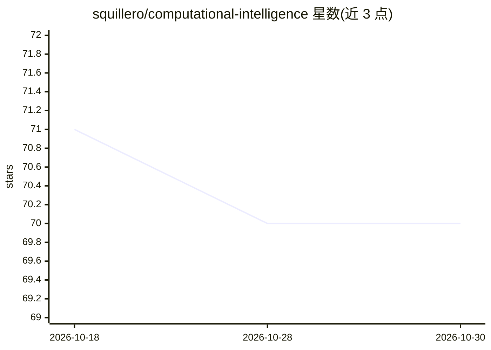

# squillero/computational-intelligence

⭐ 70 · Jupyter Notebook · NOASSERTION · 推送 2026-10-28 · [GitHub](https://github.com/squillero/computational-intelligence) · [官网](https://staff.polito.it/giovanni.squillero/lectures/) · 组织维护

**都灵理工大学计算智能课程的讲义与代码片段集**

Giovanni Squillero 在都灵理工大学讲授《计算智能》(01URROV) 课程自 2021-22 学年起积累的备用笔记、Jupyter notebook 与代码片段集合，主题涉及进化算法等计算智能内容。仓库面向修课学生与自学者，作为课程配套材料分发；复制与分发在许可条件下被允许，但文本与数据挖掘 (TDM) 依据欧盟指令 2019/790 第 4(3) 条保留权利，未经作者明示同意不得进行。

## 筛选速览

| 维度 | 判定 | 备注 |
|---|---|---|
| AI 角色 | `ai-knowledge` | 知识聚合/清单类 |
| 许可风险 | `none` | NOASSERTION |
| 部署形态 | `None` |  |
| 模型依赖 | — | README 未给出锁定关系 |
| 硬件要求 | — | 无带数字的原话,不猜 |
| 安装摩擦 | `low` | 无编译、无系统依赖或容器化 |
| 成熟度 | — | 结构信号不足 |

## 能力要点

- 收录 2021-22 学年以来的课程笔记、notebook 与代码片段
- 主题覆盖进化算法等计算智能内容
- 在许可条件下允许复制与分发文件

## 适用场景

- 修课学生获取计算智能课程的补充学习材料
- 自学者参考进化算法等主题的讲义与代码示例

## 场景标签

`教程课程` · 领域:学习与行业

## 证据(README 行号)

> L1: Computational Intelligence
> L3: Spare notes, notebooks, and code fragments from my lectures of *Computational Intelligence* (01URROV) at Politecnico

## 星数曲线

2026-10-18 71 → 2026-10-30 70（-1）

---
*卡片 v1 · prompt 1.4 · 生成 2026-10-24 · 置信度 mid · 依据 README sha `8a642dda109e` · [字段定义](../../DATASET.md)*
