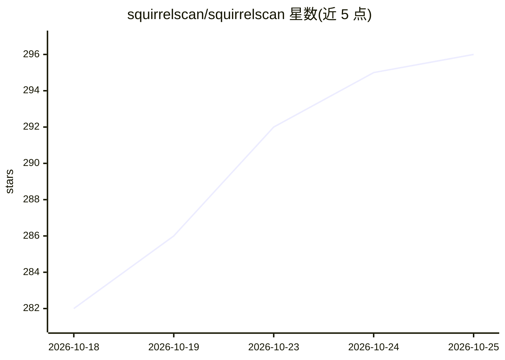

# squirrelscan/squirrelscan

⭐ 296 · TypeScript · MIT · 推送 2026-10-24 · [GitHub](https://github.com/squirrelscan/squirrelscan) · [官网](https://squirrelscan.com) · 组织维护

**面向编码代理的网站 QA 审计 CLI，300+ 规则并给出修复方案**

开源命令行工具，对网站执行确定性审计，覆盖 SEO、性能、安全、无障碍、内容与 Agent Experience 等 22 个类别共 300+ 规则，每条发现附带修复说明，输出 LLM 优化格式供编码代理直接应用。可通过 CLI、MCP 服务器（托管或本地）、skills 与 Claude Code/Cursor/Codex/opencode 插件接入，驱动"审计-修复-复审"循环。CLI 为单二进制、零依赖，本地引擎、爬虫与规则全部开源；托管 API 与云端服务为私有服务，部分功能需登录账号。

## 筛选速览

| 维度 | 判定 | 备注 |
|---|---|---|
| AI 角色 | `ai-enhanced` | 去掉 AI 部分产品仍成立 |
| 许可风险 | `permissive` | MIT |
| 部署形态 | `library` | 以包/库形式分发 |
| 模型依赖 | — | README 未给出锁定关系 |
| 硬件要求 | — | 无带数字的原话,不猜 |
| 安装摩擦 | `low` | 无编译、无系统依赖或容器化 |
| 成熟度 | — | 结构信号不足 |

## 能力要点

- 300+ 规则、22 类别的确定性网站审计
- MCP 服务器、Agent Skills 与 Claude Code/Cursor 插件多种接入方式
- 每条发现附修复说明，含 LLM 优化输出格式
- 单二进制 CLI，零依赖，支持自更新

## 适用场景

- 让编码代理自动审计并修复网站的 SEO/性能/安全问题
- 在 CI 中以 JSON 等格式输出审计结果
- 检查网站对 AI 爬虫与代理的可读性（llms.txt、AGENTS.md 等）

## 场景标签

 · 领域:Web 质量/审计工具

## 证据(README 行号)

> L7: squirrelscan is an Open Source cli tool that audits websites for SEO, performance, security, accessibility, agent ex
> L28: - **Built for coding agents** - Skills for Claude Code, Cursor, Codex and any coding agent run the audit, fix and r
> L39: - **Developer-first CLI** - Single binary, zero dependencies, shell completions, self-update.

## 星数曲线

2026-10-18 282 → 2026-10-25 296（+14）

---
*卡片 v1 · prompt 1.4 · 生成 2026-10-22 · 置信度 high · 依据 README sha `576a7d889c36` · [字段定义](../../DATASET.md)*
