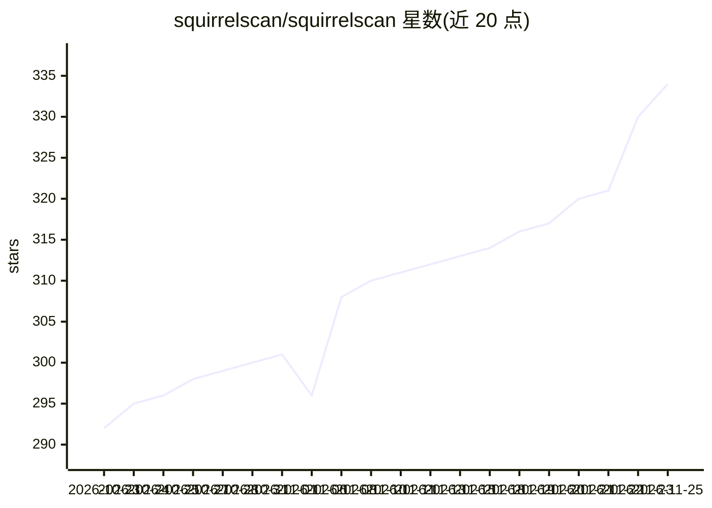

# squirrelscan/squirrelscan

⭐ 334 · TypeScript · MIT · 推送 2026-11-24 · [GitHub](https://github.com/squirrelscan/squirrelscan) · [官网](https://squirrelscan.com) · 组织维护

**给编程 Agent 用的网站 QA 审计 CLI：350+ 规则给出可执行修复**

开源 CLI 工具，对网站执行 SEO、性能、安全、可访问性、Agent 体验等 22 类 350+ 规则审计，输出健康评分、分级问题清单与可粘贴给编程 Agent 的修复提示。支持 CLI、云端、MCP 服务器与 Agent Skills 多种运行方式，配合 Claude Code、Cursor、Codex 等 Agent 形成审计—修复—复审闭环。核心为 MIT 许可，另提供登录后的云端功能：浏览器渲染、AI 页面分析、定时审计、Pro/Team 付费层的链接监控与邮件通知。

## 筛选速览

| 维度 | 判定 | 备注 |
|---|---|---|
| AI 角色 | `ai-enhanced` | 去掉 AI 部分产品仍成立 |
| 许可风险 | `permissive` | MIT |
| 部署形态 | `library` | 以包/库形式分发 |
| 模型依赖 | — | README 未给出锁定关系 |
| 硬件要求 | — | 无带数字的原话,不猜 |
| 安装摩擦 | `low` | 无编译、无系统依赖或容器化 |
| 成熟度 | — | 结构信号不足 |

## 能力要点

- 22 类 350+ 审计规则，输出健康评分与排序问题清单
- LLM 优化格式的修复建议与逐条修复提示复制
- 以 MCP 服务器、Agent Skills、插件形式接入编程 Agent
- Agent Experience 类别审计 llms.txt、AGENTS.md 与 AI 爬虫内容差异

## 适用场景

- 网站上线前审计 SEO、性能、安全与可访问性问题
- 让编程 Agent 自动完成审计、修复、复审的闭环
- 检查站点对 AI 爬虫与 Agent 的可读性与可达性
- CI 或定时任务中监控断链与站点回归

## 场景标签

 · 领域:开发工具/网站质量审计

## 证据(README 行号)

> L7: squirrelscan is an Open Source cli tool that audits websites for SEO, performance, security, accessibility, agent ex
> L31: - **Agent experience** - Audit how well AI agents can read, discover and act on your site: llms.txt, AGENTS.md, Mar
> L39: - **Developer-first CLI** - Single binary, zero dependencies, shell completions, self-update.

## 星数曲线

2026-10-23 292 → 2026-11-25 334（+42）

---
*卡片 v1 · prompt 1.4 · 生成 2026-11-25 · 置信度 mid · 依据 README sha `75b884fbd335` · [字段定义](../../DATASET.md)*
