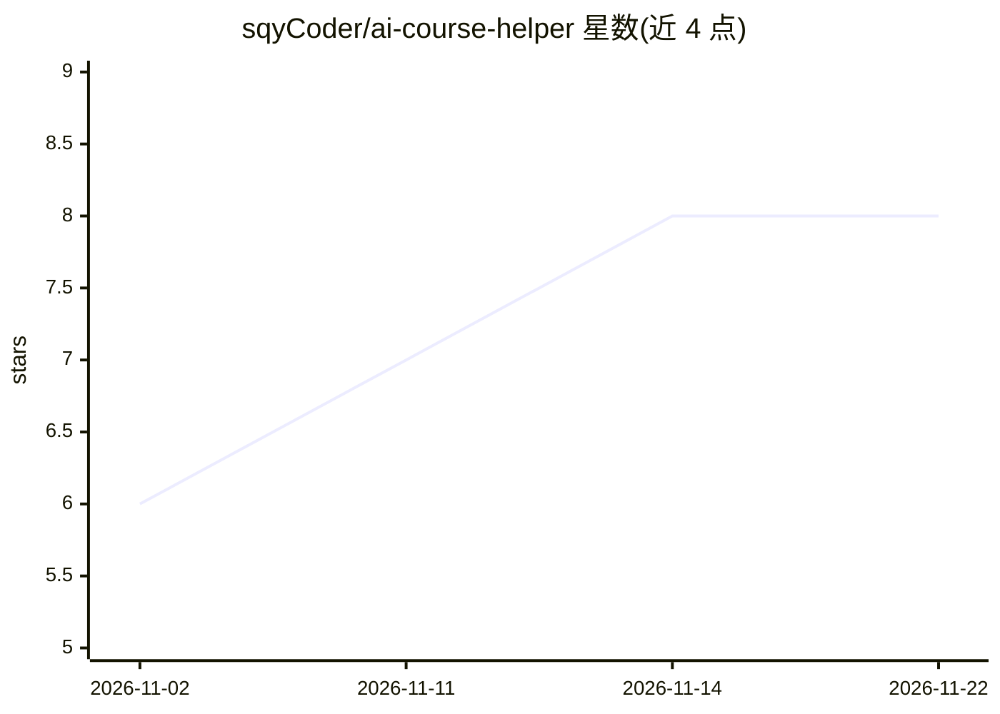

# sqyCoder/ai-course-helper

⭐ 8 · JavaScript · MIT · 推送 2026-11-01 · [GitHub](https://github.com/sqyCoder/ai-course-helper) · 个人维护 · 中文 README

**网课 MOOC 浏览器扩展：视频自动连播与测验题自动求解填充**

Manifest V3 浏览器扩展，面向需要处理在线课程任务点的用户：视频助手自动播放、设倍速、处理弹题并进入下一节，解题助手识别测验/作业题目并自动填充。解题引擎五路可插拔（网页版大模型/自建中转/本地题库/OpenAI 兼容接口/原插件服务器），外加本地题库缓存（命中零花费秒答，支持导出合并）。纯本地 DOM 操作，不上传账号、不修改课程数据；仅适配一个平台的页面结构，强依赖 DOM 选择器，独立测验页只填不提交。仅供技术学习与研究，README 明示可能违反平台服务条款。

## 筛选速览

| 维度 | 判定 | 备注 |
|---|---|---|
| AI 角色 | `ai-native` | 本体是模型或模型工具 |
| 许可风险 | `permissive` | MIT |
| 部署形态 | `None` |  |
| 模型依赖 | local-ok | 支持本地模型 |
| 硬件要求 | — | 无带数字的原话,不猜 |
| 安装摩擦 | `low` | 无编译、无系统依赖或容器化 |
| 成熟度 | — | 结构信号不足 |

## 能力要点

- 五路可插拔答题引擎（web/relay/bank/llm/origin），默认零配置可用
- 本地题库按题号/题干哈希派生 key，命中后零花费秒答并支持导出合并
- MAIN world 反检测：吞掉 ratechange/seeked 监听，每秒重申倍速
- 字体混淆题干还原：解析页面内嵌 TTF 的 cmap 并用 canvas 字形匹配还原文字

## 适用场景

- 研究复杂多 iframe 页面下的可靠 DOM 自动化技术
- 让章节视频任务点自动连播、避免手动点下一节
- 测验题先查本地题库，用久了减少引擎调用花费
- 用本机 Ollama 完全离线答题，避开云端条款风险

## 场景标签

`浏览器自动化` · 领域:效率与自动化

## 证据(README 行号)

> L10: > 一个 **Manifest V3 浏览器扩展**，只做两件事：**视频任务自动连播** 和 **测验题自动求解填充**。
> L52: 解题引擎是**可插拔**的，五种来源任选：
> L59: |**自填大模型**（`llm`）|任意 OpenAI 兼容接口（可指向本机 Ollama）|❌ 每人得自己配|本机离线免费；云端按量计费|

## 星数曲线

2026-11-02 6 → 2026-11-22 8（+2）

---
*卡片 v1 · prompt 1.4 · 生成 2026-11-20 · 置信度 high · 依据 README sha `2e3c2b2a263f` · [字段定义](../../DATASET.md)*
