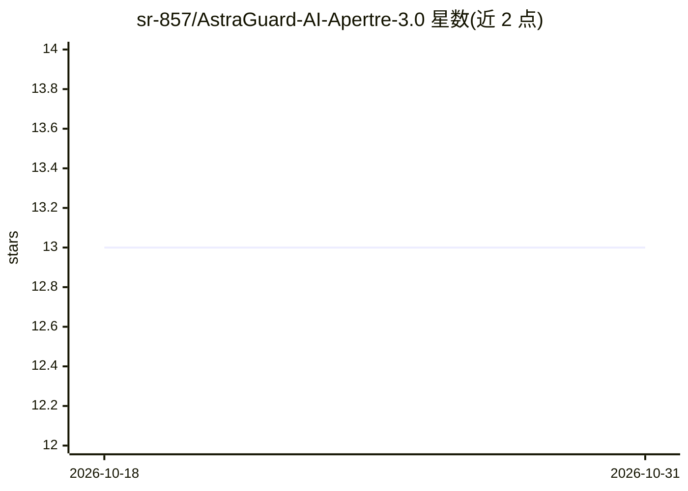

# sr-857/AstraGuard-AI-Apertre-3.0

⭐ 13 · Python · MIT · 推送 2026-07-27 · [GitHub](https://github.com/sr-857/AstraGuard-AI-Apertre-3.0) · [官网](http://astraguardsite.vercel.app) · 个人维护

**面向 CubeSat 的 AI 卫星安全与遥测异常检测系统**

面向 CubeSat 与卫星运维场景的开源安全平台：通过 Pathway/Kafka 实时摄取遥测流，经嵌入编码与自适应记忆做异常检测，按任务阶段策略自动执行恢复动作，并以 Streamlit/React 面板可视化。安全引擎集成 Scapy/Nmap 做数据包操作与扫描；AI 层基于 Ollama 本地运行 Llama 3/Mistral，进行攻击面分析、智能 payload 生成与风险评估，全部本地处理。提供 FastAPI 服务与 23 项测试。面向学生、开发者、安全从业者与航天爱好者。

## 筛选速览

| 维度 | 判定 | 备注 |
|---|---|---|
| AI 角色 | `ai-native` | 本体是模型或模型工具 |
| 许可风险 | `permissive` | MIT |
| 部署形态 | `library` | 以包/库形式分发 |
| 模型依赖 | local-ok | 支持本地模型 |
| 硬件要求 | — | 无带数字的原话,不猜 |
| 安装摩擦 | `low` | 无编译、无系统依赖或容器化 |
| 成熟度 | — | 结构信号不足 |

## 能力要点

- Pathway 实时遥测摄取（宣称 1000+ 事件/秒，MQTT/WebSocket/gRPC）
- 本地 Ollama 运行 Llama 3/Mistral 做攻击面分析与 payload 生成
- 按任务阶段差异化响应的故障恢复策略与状态机
- FastAPI REST 服务（Pydantic 校验、OpenAPI 文档、API key）

## 适用场景

- 监控 CubeSat 遥测流并自动响应异常
- 在受控环境中测试卫星应用的安全漏洞
- 学习卫星安全与 AI 集成的实际工作流

## 场景标签

`网络安全` · 领域:学习与行业

## 证据(README 行号)

> L50: - **An AI Learning System**: Uses local LLMs (Llama 3/Mistral) to analyze attack surfaces and generate smart payloa
> L213: |**🤖 AI Threat Assistant**|Local LLM-powered vulnerability analysis using Llama 3 or Mistral models|LangChain + Ol

## 星数曲线

2026-10-18 13 → 2026-10-31 13（+0）

---
*卡片 v1 · prompt 1.4 · 生成 2026-10-31 · 置信度 mid · 依据 README sha `b8cda7ca785a` · [字段定义](../../DATASET.md)*
