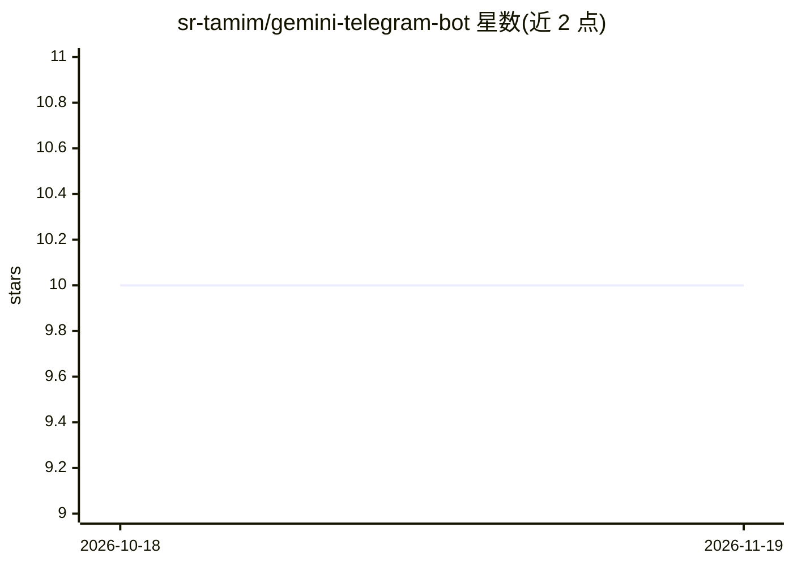

# sr-tamim/gemini-telegram-bot

⭐ 10 · TypeScript · MIT · 推送 2026-01-15 · [GitHub](https://github.com/sr-tamim/gemini-telegram-bot) · [官网](https://t.me/ai_bot_bd_public) · 个人维护

**基于 Gemini API 的 Telegram 聊天机器人**

用 Node.js 与 Telegraf 库构建的 Telegram 聊天机器人，通过 Gemini API 对用户消息生成回复，提供 /start 与 /translate 命令。部署方式为克隆仓库后用 docker compose 启动。机器人仅回复白名单群组（allowedGroups 变量）内、且是对其自身消息的回复，以防止滥用；想在自己群组使用需修改代码中的群组 ID。

## 筛选速览

| 维度 | 判定 | 备注 |
|---|---|---|
| AI 角色 | `ai-native` | 本体是模型或模型工具 |
| 许可风险 | `permissive` | MIT |
| 部署形态 | `self-host` | docker 或自建部署 |
| 模型依赖 | — | README 未给出锁定关系 |
| 硬件要求 | — | 无带数字的原话,不猜 |
| 安装摩擦 | `low` | 无编译、无系统依赖或容器化 |
| 成熟度 | — | 结构信号不足 |

## 能力要点

- 调用 Gemini API 生成对话回复
- 基于 Telegraf 库接入 Telegram Bot API
- 提供 /start 与 /translate 命令
- 通过 allowedGroups 白名单限制响应范围

## 适用场景

- 在 Telegram 群组中接入 Gemini 对话机器人
- 作为 Node.js + Gemini API 的入门示例代码
- 在受限群组内提供聊天/翻译回复

## 场景标签

`聊天机器人` · 领域:对话与助手

## 证据(README 行号)

> L8: This code is a Telegram chatbot built using the Telegraf library in Node.js. This chatbot uses the Gemini API to gen
> L25: docker compose up -d
> L33: > This chatbot can only reply to messages in specific groups, as defined in the "allowedGroups" variable and it onl

## 星数曲线

2026-10-18 10 → 2026-11-19 10（+0）

---
*卡片 v1 · prompt 1.4 · 生成 2026-11-19 · 置信度 high · 依据 README sha `28acd662fafa` · [字段定义](../../DATASET.md)*
