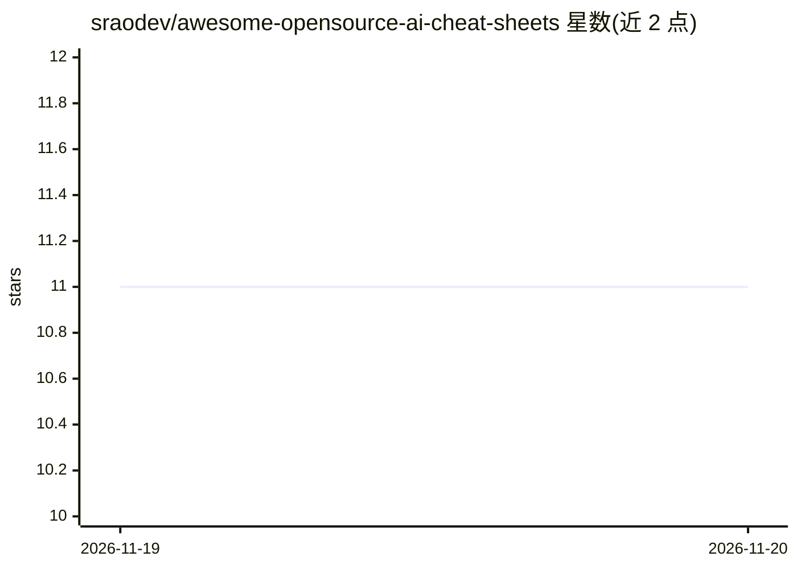

# sraodev/awesome-opensource-ai-cheat-sheets

⭐ 11 · Python · MIT · 推送 2026-08-24 · [GitHub](https://github.com/sraodev/awesome-opensource-ai-cheat-sheets) · 个人维护

**面向工程团队的开源 AI 决策速查表合集**

围绕开源 AI 系统构建、评估、安全与运维的速查表合集：每张表将一手资料整理为决策、证据记录与发布门槛，覆盖系统设计、模型与推理、微调、检索、Agent 与 MCP、多模态、评估与可观测、安全治理等 10 个主题。采用 Open Source AI Definition 1.0 区分开源 AI 与 open weights 标签；提供仓库内置的确定性校验脚本与 GitHub Actions 链接检查；条目按实用性、可维护性、无追踪链接等标准筛选。

## 筛选速览

| 维度 | 判定 | 备注 |
|---|---|---|
| AI 角色 | `ai-knowledge` | 知识聚合/清单类 |
| 许可风险 | `permissive` | MIT |
| 部署形态 | `None` |  |
| 模型依赖 | — | README 未给出锁定关系 |
| 硬件要求 | — | 无带数字的原话,不猜 |
| 安装摩擦 | `low` | 无编译、无系统依赖或容器化 |
| 成熟度 | — | 结构信号不足 |

## 能力要点

- 10 张速查表，每张输出决策、证据记录与发布门槛
- 按 Open Source AI Definition 1.0 标注开源 AI / open weights / 未验证三类
- 仓库内置 python 校验脚本，GitHub Actions 定期检查外部链接
- 附 MCP/A2A 规范、SPDX AI Profile、NIST 资源等一手参考清单

## 适用场景

- 为 AI 系统选型（模型、运行时、检索或微调）找决策依据
- 上线前按 2027 readiness 清单核对评估、安全与回滚证据
- 判断某个模型或工具是否真正满足开源定义

## 场景标签

`精选清单` · 领域:学习与行业

## 证据(README 行号)

> L11: Practical, source-backed references for building, evaluating, securing, and operating open-source AI systems and so
> L40: |Sheet|Use it when|Main deliverable|
> L53: Missing a primary source or spotted a stale claim? Open a resource or correction request or follow the focused cont

## 星数曲线

2026-11-19 11 → 2026-11-20 11（+0）

---
*卡片 v1 · prompt 1.4 · 生成 2026-11-19 · 置信度 high · 依据 README sha `5e177fff2c13` · [字段定义](../../DATASET.md)*
