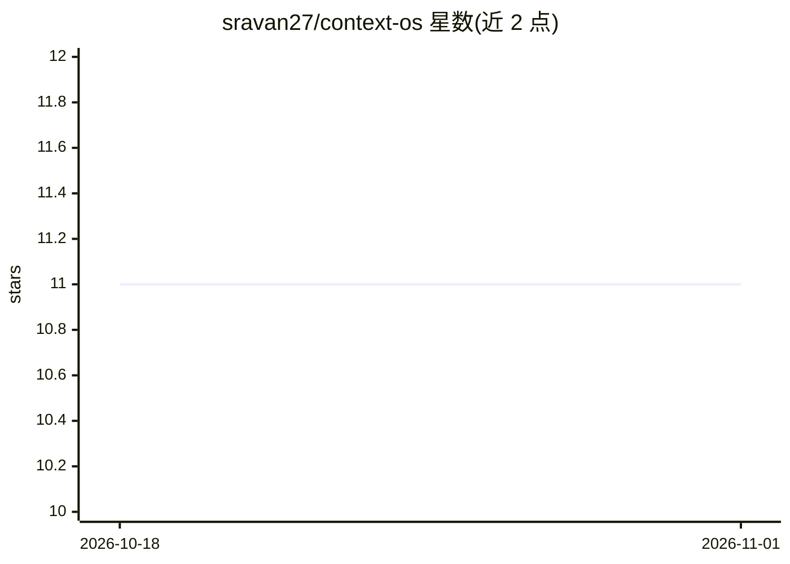

# sravan27/context-os

⭐ 11 · Python · MIT · 推送 2026-05-28 · [GitHub](https://github.com/sravan27/context-os) · [官网](https://sravan27.github.io/money-27-proof/agent-cost-leak-checker.html) · 个人维护

**为 Claude Code 注入仓库静态图的本地钩子，减少首轮探索**

约 400 行 Python 的 Claude Code hook 集合：构建仓库静态图（符号、导入、git 热点文件），在首轮对话前注入排序的 file:line 候选（auto_context）；拦截整文件读取并返回符号大纲（smart_read）；用 Stop hook 从会话转录因果性地测量节省量（savings_tracker）。无嵌入、无服务端、无模型调用，本地运行，hook 失败时 fail-open。MIT 许可，要求 python3（仅标准库），macOS/Linux 兼容。另提供付费私有仓库审计服务与 GitHub Action 成本泄漏检查。README 明确列出限制：A/B 仅 36 次冷缓存调用、符号提取基于正则且仅覆盖 Python/TS/JS/Rust/Go、每轮增加约 12–15% 输入开销。

## 筛选速览

| 维度 | 判定 | 备注 |
|---|---|---|
| AI 角色 | `ai-ecosystem` | LLM/agent 周边工具 |
| 许可风险 | `permissive` | MIT |
| 部署形态 | `None` |  |
| 模型依赖 | — | README 未给出锁定关系 |
| 硬件要求 | — | 无带数字的原话,不猜 |
| 安装摩擦 | `low` | 无编译、无系统依赖或容器化 |
| 成熟度 | — | 结构信号不足 |

## 能力要点

- 首轮前注入静态图排序的 file:line 候选，跳过 Glob→Grep 探索
- smart_read 拦截整文件读取，返回符号大纲与行区间
- 从真实转录因果性测量节省量，本地无回传
- 9 个 stdlib-Python hooks 与 31 项技术经 setup.sh 安装，全部 fail-open

## 适用场景

- 让 Claude Code 首轮直接打开正确文件，减少工具调用
- 回测自己会话历史评估节省效果（无需 API key）
- 团队用 GitHub Action 做 agent 成本泄漏检查

## 场景标签

 · 领域:AI 编程工具/上下文工程

## 证据(README 行号)

> L7: **Claude Code's first turn opens the right file instead of grepping for it.** A 400-line Python hook builds a static
> L176: Three hooks are the heart of it, all backed by one graph: **`auto_context.py`** (UserPromptSubmit — retrieval, ski
> L181: - No proxy. Claude Code talks to Anthropic directly.

## 星数曲线

2026-10-18 11 → 2026-11-01 11（+0）

---
*卡片 v1 · prompt 1.4 · 生成 2026-11-01 · 置信度 high · 依据 README sha `2d3005bc15ec` · [字段定义](../../DATASET.md)*
