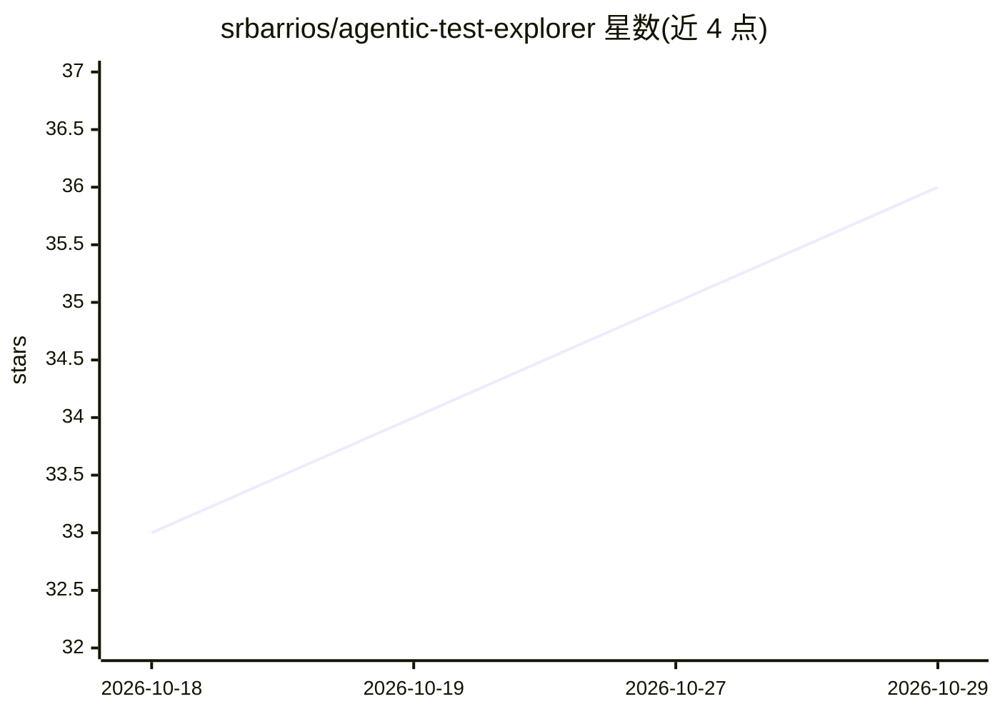

# srbarrios/agentic-test-explorer

⭐ 36 · Python · MIT · 推送 2026-10-19 · [GitHub](https://github.com/srbarrios/agentic-test-explorer) · [官网](https://oscarbarrios.tech/agentic-test-explorer/) · 个人维护

**AI 驱动的通用 Web 探索性测试框架：多 agent 操控浏览器找 bug**

面向 QA 工程师与开发者的产品无关探索性测试框架：通过 config.yaml 配置目标 Web 应用，由 LangGraph Swarm 架构的 Supervisor-Worker 多 agent（3 个标准 QA 人格 + 高级探索/混沌 agent）驱动 Playwright 浏览器执行测试。agent 发出 JSON 意图，确定性引擎执行并记录 Action Tape，发现的 bug 自动生成可复现的 Playwright 脚本；支持从 GitHub PR diff 自动生成测试任务、四层跨会话记忆（Langmem）、自配置 MCP 服务器与 Agent Skills。LLM 支持 Claude（默认，API key / Vertex AI）与 Gemini，需 Python 3.11+。

## 筛选速览

| 维度 | 判定 | 备注 |
|---|---|---|
| AI 角色 | `ai-ecosystem` | LLM/agent 周边工具 |
| 许可风险 | `permissive` | MIT |
| 部署形态 | `library` | 以包/库形式分发 |
| 模型依赖 | locked-api |  |
| 硬件要求 | — | 无带数字的原话,不猜 |
| 安装摩擦 | `low` | 无编译、无系统依赖或容器化 |
| 成熟度 | — | 结构信号不足 |

## 能力要点

- LangGraph Swarm 多 agent 驱动 Playwright 执行探索性测试
- 每个 bug 自动生成可复现的 reproduction_*.spec.ts Playwright 脚本
- 传入 GitHub PR URL 自动生成针对受影响 UI 区域的测试任务
- 四层跨会话记忆（语义/情景/程序/优先级）基于 Langmem

## 适用场景

- 让 AI agent 对任意 Web 应用做无脚本探索性测试并产出报告
- 根据 PR 变更自动生成并执行针对性回归测试
- 积累跨会话的应用知识与 bug 目录做持续回归测试

## 场景标签

`浏览器自动化` `多智能体` · 领域:Agent 开发

## 证据(README 行号)

> L8: Powered by a **LangGraph Swarm** architecture, **Playwright**, and your choice of
> L38: 1. **Mission Dispatcher (`main.py`)**: Loads `missions/*.yaml` files and provisions the
> L82: - `src/agentic_explorer/main.py` — CLI entry, swarm graph compiler, transient-error retry

## 星数曲线

2026-10-18 33 → 2026-10-29 36（+3）

---
*卡片 v1 · prompt 1.4 · 生成 2026-10-25 · 置信度 mid · 依据 README sha `e745f80bcf60` · [字段定义](../../DATASET.md)*
