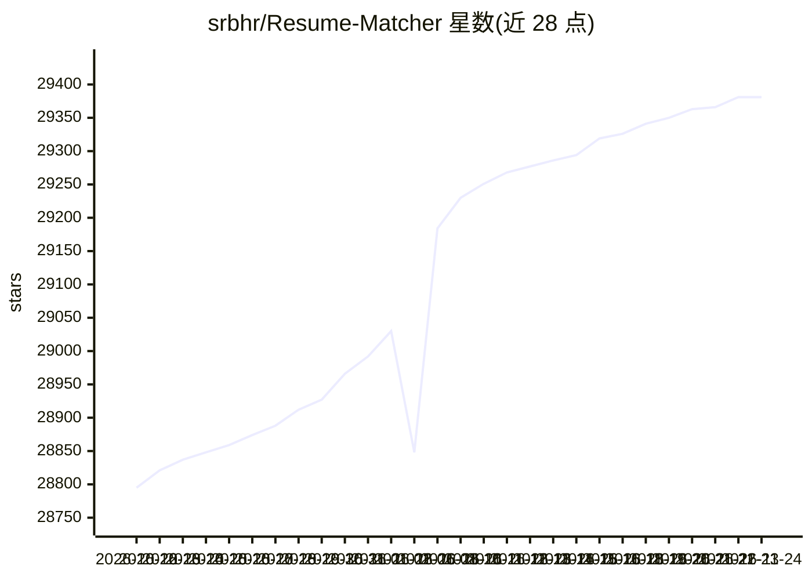

# srbhr/Resume-Matcher

⭐ 29,381 · Python · Apache-2.0 · 推送 2026-11-20 · [GitHub](https://github.com/srbhr/Resume-Matcher) · [官网](https://resumematcher.fyi/) · 组织维护 · 中文 README

**面向求职者的本地自托管 AI 简历定制与简历构建工具**

自托管的简历定制工具：用户先建一份 master resume，粘贴目标职位描述后由 LLM 生成针对该岗位的定制简历与求职信，并支持面试准备、后台批量定制队列。关键机制包括纯代码实现的 ATS 评分（关键词 40%/技能 20%/职位名 15%/章节完整性 15%/日期一致性 10%）与 ATS 解析检查（经 pdfminer 提取文本）、防止编造经历的定制提示词约束、多种可解析 PDF 模板。技术栈为 FastAPI + Next.js + SQLite，支持多语言 UI 与内容生成。

## 筛选速览

| 维度 | 判定 | 备注 |
|---|---|---|
| AI 角色 | `ai-native` | 本体是模型或模型工具 |
| 许可风险 | `permissive` | Apache-2.0 |
| 部署形态 | `self-host` | docker 或自建部署 |
| 模型依赖 | local-ok | 支持本地模型 |
| 硬件要求 | — | 无带数字的原话,不猜 |
| 安装摩擦 | `low` | 无编译、无系统依赖或容器化 |
| 成熟度 | — | 结构信号不足 |

## 动量与使用信号

- 维护:`active` — 距上次 push 1.1 天,年发版 4,96 位贡献者
- 涨星:近 1 天 **+48**(自 20261016 起算)
- 平台:— · 协议:MCP / OLLAMA

## 能力要点

- 支持 100+ LLM：API key（OpenAI/Anthropic/Gemini/DeepSeek/OpenRouter/Groq）或本地 Ollama
- 纯代码 ATS 评分与解析检查，不做 LLM 调用
- MCP 服务器让 Claude Code/Cursor/Codex 驱动，无需 API key
- 七种模板提供可编辑 pdfLaTeX 项目，支持 A4/US Letter 文本型 PDF 导出

## 适用场景

- 针对不同职位描述定制同一份 master resume
- 本地运行 Ollama 让简历数据不出本机
- 批量粘贴多个 JD 在后台依次生成定制简历
- 用 ATS 检查核验 PDF 能否被招聘系统正确解析

## 场景标签

`AI 写作` · 领域:内容生成

## 证据(README 行号)

> L9: Free, open-source resume builder that tailors your resume (CV) to each job description. A self-hosted AI harness for
> L47: - **It runs on your machine.** A FastAPI backend, a Next.js frontend and a SQLite file. Clone the repo or start one
> L151: ### ATS Score, ATS Check & Keyword Highlighting

## 星数曲线

2026-10-22 28,795 → 2026-11-24 29,381（+586）

---
*卡片 v1 · prompt 1.4 · 生成 2026-11-22 · 置信度 high · 依据 README sha `1cbc73713f51` · [字段定义](../../DATASET.md)*
