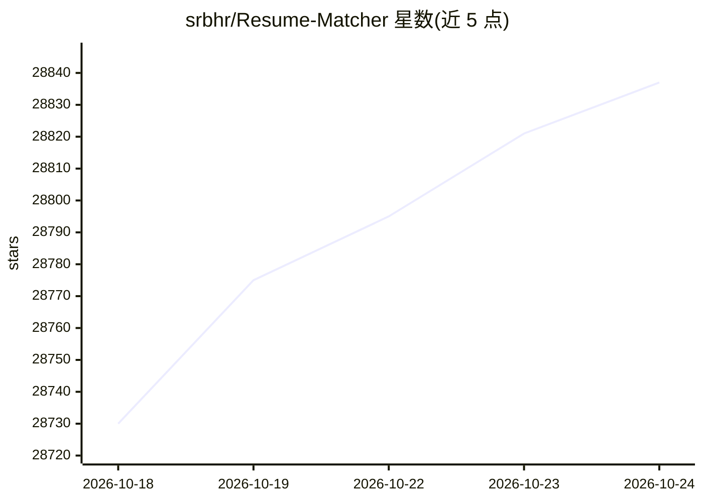

# srbhr/Resume-Matcher

⭐ 28,837 · Python · Apache-2.0 · 推送 2026-10-23 · [GitHub](https://github.com/srbhr/Resume-Matcher) · [官网](https://resumematcher.fyi/) · 个人维护

**本地自托管的 AI 简历定制与 ATS 优化工具**

开源简历工具：上传主简历（PDF/DOCX）与目标职位描述，生成针对该职位的定制简历、求职信与面试准备内容，并导出可被 ATS 解析的 PDF。架构为 FastAPI 后端 + Next.js 前端 + SQLite，本机运行、无需注册账号，数据存于本地数据库。支持接入云端 API 或本地模型（Ollama）；另提供 MCP 服务器，可由 Claude Code、Cursor 等编码代理驱动生成，无需 LLM key。ATS 评分与 ATS 检查为纯代码实现，不调用 LLM。定制提示词禁止添加主简历中不存在的经历。

## 筛选速览

| 维度 | 判定 | 备注 |
|---|---|---|
| AI 角色 | `ai-enhanced` | 去掉 AI 部分产品仍成立 |
| 许可风险 | `permissive` | Apache-2.0 |
| 部署形态 | `self-host` | docker 或自建部署 |
| 模型依赖 | local-ok | 支持本地模型 |
| 硬件要求 | — | 无带数字的原话,不猜 |
| 安装摩擦 | `low` | 无编译、无系统依赖或容器化 |
| 成熟度 | — | 结构信号不足 |

## 动量与使用信号

- 维护:`active` — 距上次 push 1.1 天,年发版 4,96 位贡献者
- 涨星:近 1 天 **+48**(自 20261016 起算)
- 平台:— · 协议:MCP / OLLAMA

## 能力要点

- 主简历+职位描述生成定制简历、求职信与面试准备
- 支持云端 API 与本地模型（Ollama），数据留在本机
- ATS 评分与解析检查为纯代码（pdfminer），不调用 LLM
- 10 套模板，其中 7 套提供可编辑 pdfLaTeX 工程；多语言界面与内容生成

## 适用场景

- 针对每个职位描述定制主简历并导出 PDF
- 用 ATS 检查核验简历 PDF 的可解析性
- 本地模型运行下让简历数据不出本机
- 批量粘贴多个职位描述排队后台定制

## 场景标签

`AI 写作` `文档解析` · 领域:内容生成

## 证据(README 行号)

> L47: - **It runs on your machine.** A FastAPI backend, a Next.js frontend and a SQLite file. Clone the repo or start one
> L48: - **You choose the model.** Bring an API key for OpenAI, Anthropic, Gemini, DeepSeek, OpenRouter or Groq, or run a 
> L49: - **Claude Code can drive it.** The MCP server lets Claude Code, Cursor or Codex write the tailored resume while Re

## 星数曲线

2026-10-18 28,730 → 2026-10-24 28,837（+107）

---
*卡片 v1 · prompt 1.4 · 生成 2026-10-18 · 置信度 high · 依据 README sha `73ad0e5f8fc5` · [字段定义](../../DATASET.md)*
