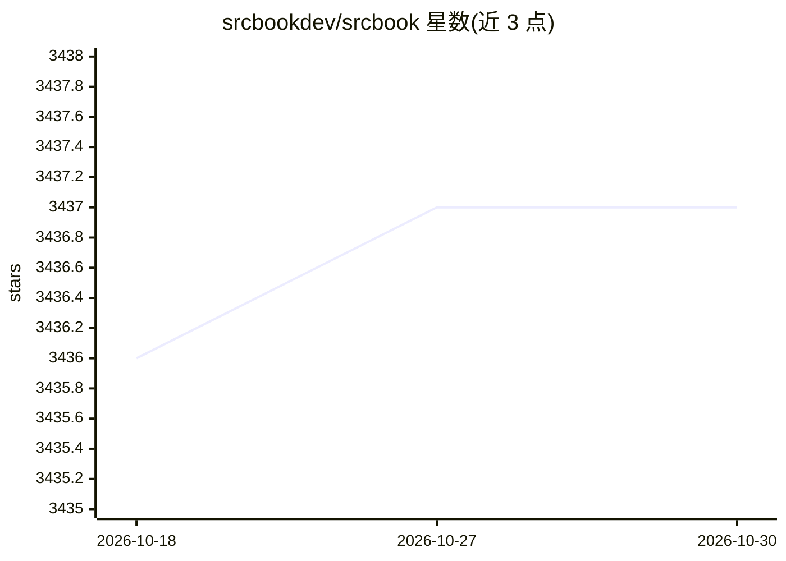

# srcbookdev/srcbook

⭐ 3,437 · TypeScript · Apache-2.0 · 推送 2026-07-30 · [GitHub](https://github.com/srcbookdev/srcbook) · 组织维护

**本地运行的 TypeScript notebook，支持 AI 辅助探索代码与想法**

基于 Node.js 的 TypeScript notebook，以 CLI 应用加 Web 界面的形式在本地运行，支持创建、运行、分享 notebook，导出为 markdown（.src.md），内置 mermaid 图表标注。AI 功能用于探索与迭代想法，需自带 API key（README 推荐 Anthropic claude-3-5-sonnet-latest）。要求 Node 18+ 与 corepack，可通过 npx/pnpm dlx 或 Docker 运行，本地端口 2150。README 声明项目已不再处于活跃开发状态。

## 筛选速览

| 维度 | 判定 | 备注 |
|---|---|---|
| AI 角色 | `ai-enhanced` | 去掉 AI 部分产品仍成立 |
| 许可风险 | `permissive` | Apache-2.0 |
| 部署形态 | `self-host` | docker 或自建部署 |
| 模型依赖 | — | README 未给出锁定关系 |
| 硬件要求 | — | 无带数字的原话,不猜 |
| 安装摩擦 | `low` | 无编译、无系统依赖或容器化 |
| 成熟度 | — | 结构信号不足 |

## 能力要点

- TypeScript notebook 本地运行，Web 界面访问
- notebook 可导出为 .src.md markdown 格式
- AI 功能用于探索和迭代想法，需自带 API key
- 内置行为分析统计，可用 SRCBOOK_DISABLE_ANALYTICS=true 关闭

## 适用场景

- 在本地以 notebook 形式编写和运行 TypeScript 代码
- 借助 AI 探索和迭代代码想法
- 将 notebook 导出为 markdown 分享

## 场景标签

`代码生成` · 领域:编码与开发

## 证据(README 行号)

> L17: Srcbook is a TypeScript notebook that runs locally on your machine.
> L25: - AI features for exploring and iterating on ideas

## 星数曲线

2026-10-18 3,436 → 2026-10-30 3,437（+1）

---
*卡片 v1 · prompt 1.4 · 生成 2026-10-20 · 置信度 high · 依据 README sha `68fb807fbd49` · [字段定义](../../DATASET.md)*
