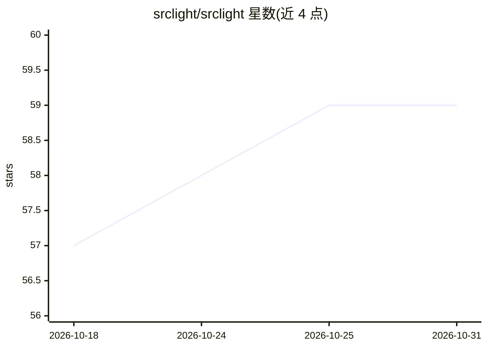

# srclight/srclight

⭐ 59 · Python · MIT · 推送 2026-10-14 · [GitHub](https://github.com/srclight/srclight) · [官网](https://srclight.dev) · 组织维护

**供 AI 编码代理查询的本地代码索引 MCP 服务器**

面向 AI 编码代理的 MCP 服务器：用 SQLite FTS5、tree-sitter 与 embeddings 为代码库建立可查询索引，通过 MCP 暴露 42 个工具，覆盖符号搜索、调用关系图、语义搜索、git 变更情报与文档提取等；也可经 CLI 直接调用同一批工具。支持多仓库工作区、混合检索（RRR 融合关键词与语义结果）、19 种语言索引与 10 种文档格式。完全本地运行，无云端依赖；语义搜索需自备 Ollama 与嵌入模型，OCR 与 GPU 向量加速为可选功能。以 Python 包（3.11+）形式从 PyPI 安装。

## 筛选速览

| 维度 | 判定 | 备注 |
|---|---|---|
| AI 角色 | `ai-ecosystem` | LLM/agent 周边工具 |
| 许可风险 | `permissive` | MIT |
| 部署形态 | `self-host` | docker 或自建部署 |
| 模型依赖 | local-ok | 支持本地模型 |
| 硬件要求 | — | 无带数字的原话,不猜 |
| 安装摩擦 | `low` | 无编译、无系统依赖或容器化 |
| 成熟度 | — | 结构信号不足 |

## 能力要点

- SQLite FTS5 + tree-sitter + embeddings 的本地代码索引，42 个 MCP 工具
- 4 种搜索模式（符号/源码/文档/语义）+ RRF 混合检索
- 索引新鲜度与覆盖缺口自报告（index_freshness / index_status）
- 多仓库工作区，经 SQLite ATTACH+UNION 跨库检索

## 适用场景

- 让 Claude Code / Cursor 等 MCP 客户端以结构化查询代替多轮 grep 定位代码
- 提交前通过调用图与影响分析查看修改波及范围
- 在离线/内网环境为编码代理提供代码语义检索

## 场景标签

`语义搜索` · 领域:知识与检索

## 证据(README 行号)

> L9: Srclight builds a rich, searchable index of your codebase that AI coding agents can query instantly — replacing doze
> L35: - **MCP server** — works with Claude Code, Cursor, and any MCP client

## 星数曲线

2026-10-18 57 → 2026-10-31 59（+2）

---
*卡片 v1 · prompt 1.4 · 生成 2026-10-24 · 置信度 mid · 依据 README sha `2817c65e5ff1` · [字段定义](../../DATASET.md)*
