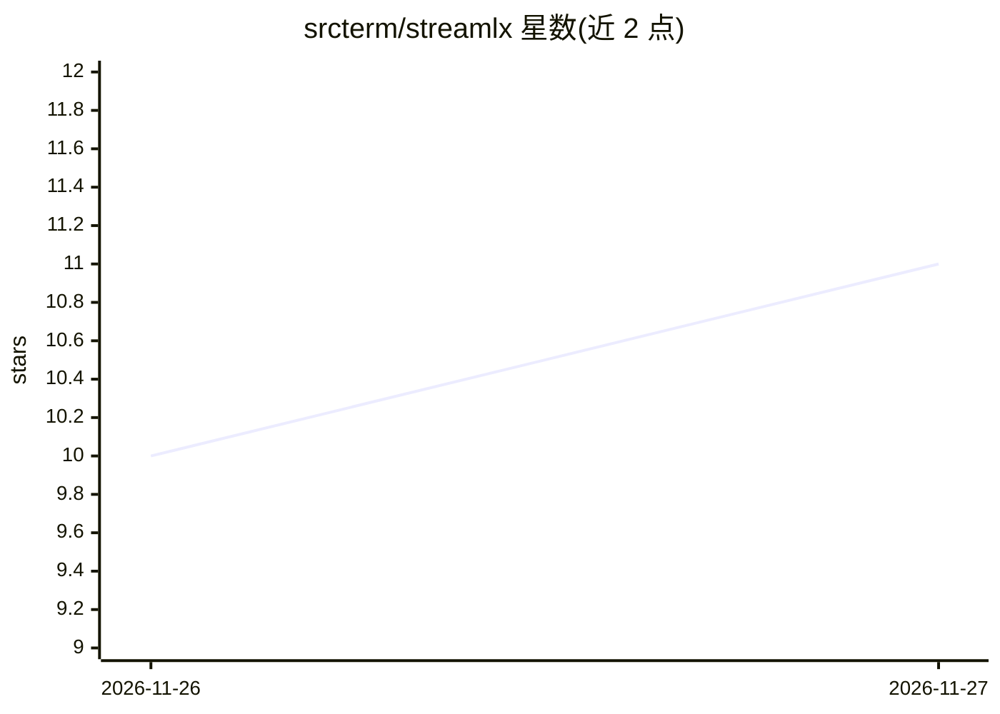

# srcterm/streamlx

⭐ 11 · Python · MIT · 推送 2026-11-26 · [GitHub](https://github.com/srcterm/streamlx) · 个人维护

**在 Apple Silicon 上用 SSD 流式读取运行超大 MoE 模型的推理引擎**

基于 MLX 的 MoE 模型 SSD 流式推理引擎：稠密部分留在内存、路由专家按需从 SSD 读取，向编码 agent 提供超出内存容量的模型检查点服务。机制包括流水线化专家预取、查找式草稿、读取与计算重叠、SSD 上的 prompt 缓存、默认内存上限。输出与原模型逐 token 一致。限制：仅限 Apple Silicon 与 macOS 14+、单请求运行、仅本地检查点目录、流水线解码仅覆盖贪心请求。

## 筛选速览

| 维度 | 判定 | 备注 |
|---|---|---|
| AI 角色 | `ai-ecosystem` | LLM/agent 周边工具 |
| 许可风险 | `permissive` | MIT |
| 部署形态 | `library` | 以包/库形式分发 |
| 模型依赖 | — | README 未给出锁定关系 |
| 硬件要求 | — | 无带数字的原话,不猜 |
| 安装摩擦 | `low` | 无编译、无系统依赖或容器化 |
| 成熟度 | `idea` | |

## 能力要点

- 检查点大于内存：343 GB 模型可在 32 GB MacBook 上运行
- 提供 OpenAI 兼容服务器（localhost:8080/v1）供编码 agent 或客户端接入
- 查找式草稿：从对话中已有文本草拟并单步校验 token
- 提供 Python API 与 generate/validate 子命令

## 适用场景

- 在内存不足的 MacBook 上为编码 agent 提供大 MoE 模型服务
- 本地推理超出内存容量的 DeepSeek/Qwen MoE 检查点
- 测量不同模型在 SSD 流式下的速度与内存数据

## 场景标签

`推理引擎` · 领域:训练与推理

## 证据(README 行号)

> L15: That is an OpenAI-compatible server on `http://localhost:8080/v1` for a coding agent or any client. The model is a 
> L28: - **Stock models and checkpoints.** Only the expert layer is swapped; checkpoints are read in place and the server 
> L103: - Apple Silicon with macOS 14 or later (MLX's requirement), one request at a time, local checkpoint directories.

## 星数曲线

2026-11-26 10 → 2026-11-27 11（+1）

---
*卡片 v1 · prompt 1.4 · 生成 2026-11-26 · 置信度 high · 依据 README sha `b833677ea530` · [字段定义](../../DATASET.md)*
