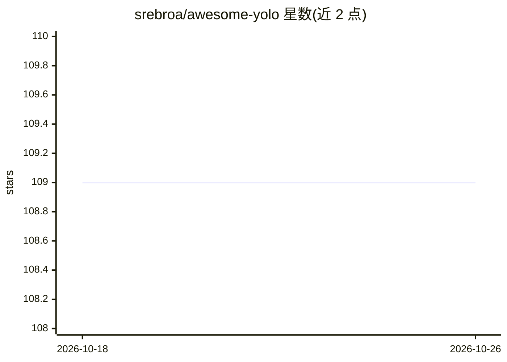

# srebroa/awesome-yolo

⭐ 109 · 推送 2026-02-14 · [GitHub](https://github.com/srebroa/awesome-yolo) · 个人维护

**YOLO 系列目标检测算法的策展清单与基准对比**

收录 YOLO v1 至 YOLO26 共 30 余个目标检测算法条目的清单：每条含年份、作者、论文出处与要点，并附小模型横向对比表（参数量/FLOPs/V100 FPS/mAP/许可证）。另整理检测评估指标（Accuracy/Precision/Recall/F1/AP/mAP/IoU/FPS 等）的定义与公式、模型测试对比链接及无人机南瓜检测、管道计数等实践示例。面向计算机视觉开发者与研究者作选型参考，本仓库不含可运行代码或安装方式。

## 筛选速览

| 维度 | 判定 | 备注 |
|---|---|---|
| AI 角色 | `ai-knowledge` | 知识聚合/清单类 |
| 许可风险 | `none` | — |
| 部署形态 | `None` |  |
| 模型依赖 | — | README 未给出锁定关系 |
| 硬件要求 | — | 无带数字的原话,不猜 |
| 安装摩擦 | `low` | 无编译、无系统依赖或容器化 |
| 成熟度 | — | 结构信号不足 |

## 能力要点

- 按年份收录 YOLO v1 至 YOLO26 各版本条目及论文出处
- 小模型对比表含参数量/FLOPs/FPS/mAP/许可证
- 整理 mAP/IoU/F1 等检测评估指标的定义与公式
- 附模型测试对比与实际应用示例链接

## 适用场景

- 选型时横向对比各代 YOLO 小模型的精度与速度
- 查找某个 YOLO 版本的论文出处与架构要点
- 了解目标检测常用评估指标的含义与公式

## 场景标签

`精选清单` · 领域:学习与行业

## 证据(README 行号)

> L1: # awesome-yolo :rocket: :star:
> L9: # YOLO - You Only Looks Once
> L39: # Object Detection DNN Algorithms Benchmark

## 星数曲线

2026-10-18 109 → 2026-10-26 109（+0）

---
*卡片 v1 · prompt 1.4 · 生成 2026-10-23 · 置信度 high · 依据 README sha `5d1586f045c1` · [字段定义](../../DATASET.md)*
