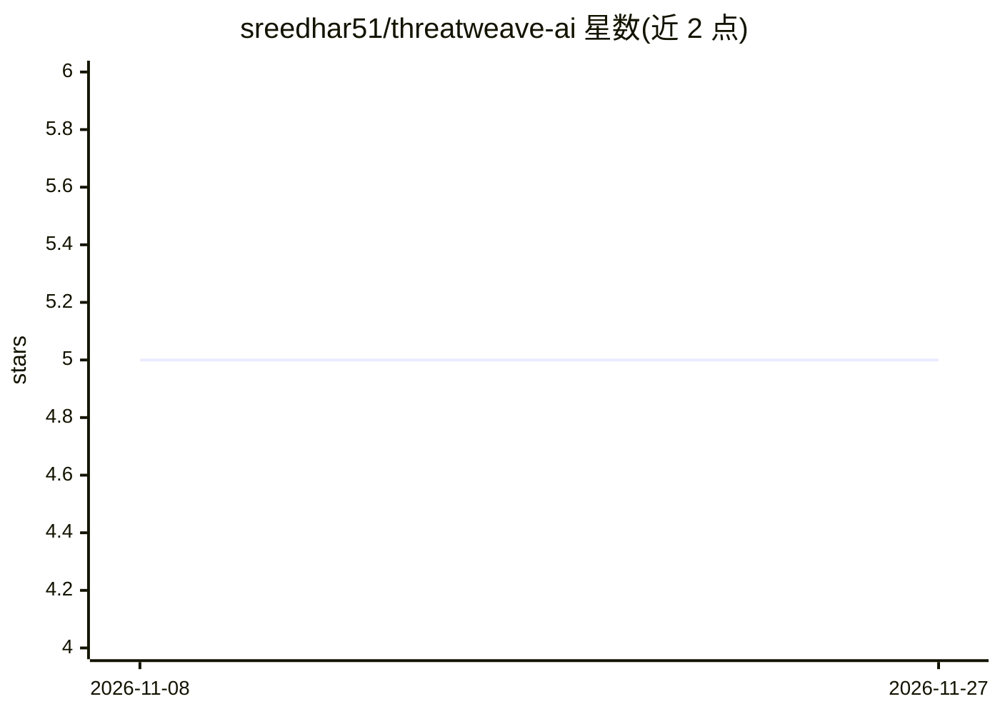

# sreedhar51/threatweave-ai

⭐ 5 · Python · MIT · 推送 2026-11-18 · [GitHub](https://github.com/sreedhar51/threatweave-ai) · 个人维护

**安全分析者的漏洞与 CIS 合规关联优先级排序 agent**

面向企业漏洞管理流程的只读 agent：汇总 Tenable 漏洞导出、.nessus 文件、CIS 合规结果与 ServiceNow CMDB 导出，在相同资产 UUID 上按人工审核的规则做关联，再由确定性 YAML 策略引擎生成排序的修复组清单。每次运行产出 Decision Receipt 指纹，Decision Replay 可比较两次运行并归因排序变化。Claude 负责撰写决策简报、提出新关联规则草案与回答问题，所有输出仅作建议，须人工确认；评分与排序完全由引擎完成。需 Python 3.11+，离线演示无需 Tenable 账户或 API key。

## 筛选速览

| 维度 | 判定 | 备注 |
|---|---|---|
| AI 角色 | `ai-native` | 本体是模型或模型工具 |
| 许可风险 | `permissive` | MIT |
| 部署形态 | `desktop` | 安装包/桌面程序 |
| 模型依赖 | locked-api |  |
| 硬件要求 | — | 无带数字的原话,不猜 |
| 安装摩擦 | `low` | 无编译、无系统依赖或容器化 |
| 成熟度 | — | 结构信号不足 |

## 能力要点

- 基于同资产 UUID 与已审核规则的漏洞-CIS 关联，禁止按主机名/IP 合并
- 确定性策略引擎评分排序，每次运行产出可复现的 Decision Receipt
- Decision Replay 归因排序变化来源（策略/数据）
- Claude 输出经 schema 校验，疑似 prompt injection 的证据被跳过或标记

## 适用场景

- 把漏洞扫描、CIS 审计与 CMDB 资产归属合并成一份优先级清单
- 向管理层解释优先级为何发生变化并出示证据
- 在离线演示数据上演练修复组调查流程

## 场景标签

`网络安全` · 领域:学习与行业

## 证据(README 行号)

> L12: top priority is not today's. ThreatWeave is a read-only Claude agent that does the
> L56:  list of candidate fix groups. This step is fully deterministic: Claude never scores
> L58: 5. **Advise.** Claude writes a decision brief for each top group, proposes new

## 星数曲线

2026-11-08 5 → 2026-11-27 5（+0）

---
*卡片 v1 · prompt 1.4 · 生成 2026-11-21 · 置信度 high · 依据 README sha `e2df5809f91e` · [字段定义](../../DATASET.md)*
