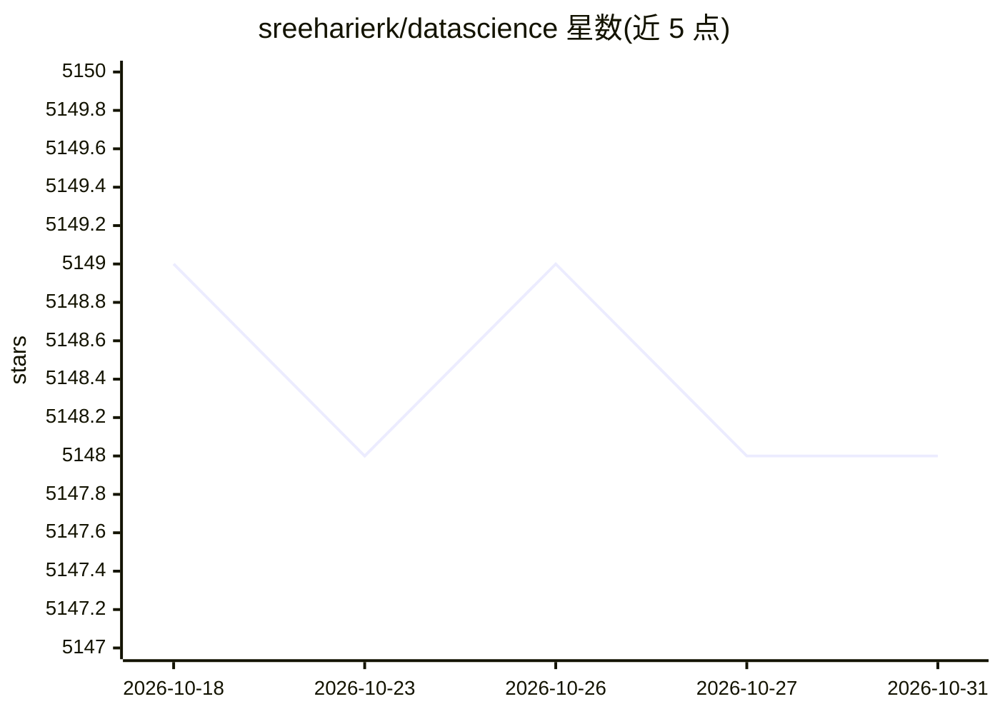

# sreeharierk/datascience

⭐ 5,148 · GPL-3.0 · 推送 2026-02-01 · [GitHub](https://github.com/sreeharierk/datascience) · [官网](https://twitter.com/sreeharierk) · 个人维护

**数据科学学习路线图：免费资源与概念讲解合集**

一份 Data Scientist Roadmap（2021）文档，按主题组织数据科学学习内容：基础（矩阵、哈希、SQL 连接、CAP 定理、ETL、NoSQL、正则）、统计学（描述统计、EDA、PCA）等章节，每节给出概念定义、SQL/Python 示例与外部资源链接（如 KAGGLE、regexr.com），并在 Python 章节附 numpy/matplotlib/pandas/seaborn 的安装与用法。README 本身不提供本仓库的安装或运行方式，属纯文档型学习资源。限制：内容标注 2021 年，未声明维护状态。

## 筛选速览

| 维度 | 判定 | 备注 |
|---|---|---|
| AI 角色 | `ai-knowledge` | 知识聚合/清单类 |
| 许可风险 | `viral` | GPL-3.0 |
| 部署形态 | `desktop` | 安装包/桌面程序 |
| 模型依赖 | — | README 未给出锁定关系 |
| 硬件要求 | — | 无带数字的原话,不猜 |
| 安装摩擦 | `low` | 无编译、无系统依赖或容器化 |
| 成熟度 | — | 结构信号不足 |

## 能力要点

- 按路线图结构分章节组织：基础、统计学等主题
- 每节提供概念定义与 SQL/JSON/XML 示例
- 附数据集仓库（KAGGLE、PMC 等）与外部学习链接

## 适用场景

- 按路线图系统自学数据科学基础知识
- 查找数据集仓库与 Python 统计分析库入门示例

## 场景标签

`教程课程` `精选清单` · 领域:学习与行业

## 证据(README 行号)

> L1: # Data-Scientist-Roadmap (2021)
> L3: roadmap-picture

## 星数曲线

2026-10-18 5,149 → 2026-10-31 5,148（-1）

---
*卡片 v1 · prompt 1.4 · 生成 2026-10-20 · 置信度 mid · 依据 README sha `53dd6efebacf` · [字段定义](../../DATASET.md)*
