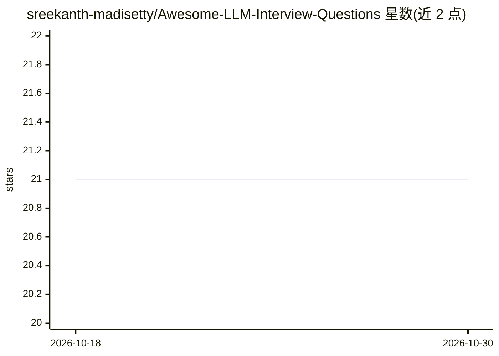

# sreekanth-madisetty/Awesome-LLM-Interview-Questions

⭐ 21 · Apache-2.0 · 推送 2026-07-12 · [GitHub](https://github.com/sreekanth-madisetty/Awesome-LLM-Interview-Questions) · [官网](https://github.com/sreekanth-madisetty/Awesome-LLM-Interview-Questions) · 个人维护

**LLM 面试题与专家答案的策展清单，供求职者备考**

面向准备 Data Scientist、ML Engineer、AI Researcher 等岗位面试的策展仓库：收录围绕大语言模型的面试问题与答案，覆盖基础概念、前沿进展、真实应用与系统级设计，并附资源列表与目录导航。README 未展示具体题目条目与工具链，内容以链接/清单形式组织。仓库为个人维护的知识集合，无代码、无安装运行流程。

## 筛选速览

| 维度 | 判定 | 备注 |
|---|---|---|
| AI 角色 | `ai-knowledge` | 知识聚合/清单类 |
| 许可风险 | `permissive` | Apache-2.0 |
| 部署形态 | `None` |  |
| 模型依赖 | — | README 未给出锁定关系 |
| 硬件要求 | — | 无带数字的原话,不猜 |
| 安装摩擦 | `low` | 无编译、无系统依赖或容器化 |
| 成熟度 | — | 结构信号不足 |

## 能力要点

- 收录 LLM 面试问题与专家答案
- 覆盖基础概念、前沿进展、应用与系统设计
- 附面试准备资源列表与目录

## 适用场景

- 准备 Data Scientist / ML Engineer / AI Researcher 面试
- 梳理 LLM 相关知识体系与考点

## 场景标签

`精选清单` · 领域:学习与行业

## 证据(README 行号)

> L2: A curated collection of interview questions and answers focused on Large Language Models (LLMs) — covering foundatio
> L6: List of resources useful for preparing AI or LLM Engineer interviews can be found below.

## 星数曲线

2026-10-18 21 → 2026-10-30 21（+0）

---
*卡片 v1 · prompt 1.4 · 生成 2026-10-28 · 置信度 high · 依据 README sha `9a601dc1ece7` · [字段定义](../../DATASET.md)*
