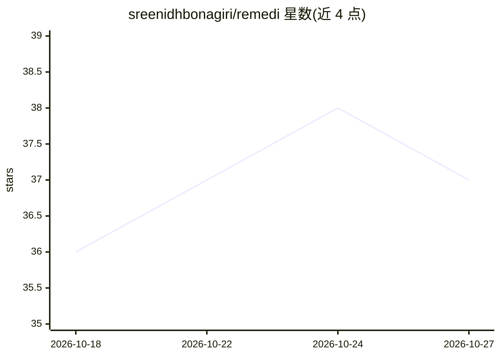

# sreenidhbonagiri/remedi

⭐ 37 · Python · MIT · 推送 2026-09-06 · [GitHub](https://github.com/sreenidhbonagiri/remedi) · [官网](https://remedi-copilot.onrender.com) · 个人维护

**帮助患者查找平价仿制药与药企援助项目的 Web 平台**

基于 FastAPI 的处方药费用援助导航 Web 服务：通过 OpenFDA 与 FDA Orange Book 数据交叉检索治疗等效（TE 代码 AB）的仿制药替代方案并计算费用差；按 2026 年 HHS 联邦贫困线标准与家庭收入确定性判定患者援助项目（PAPs）资格；由 LangGraph 状态机驱动的 Remy 临床副驾驶处理对话，LLM 被限制不得直接做算术或引用无数据库依据的价格；用 ReportLab 在内存中流式生成预填援助申请 PDF。声明不提供临床诊断，处方替换需执业医师授权。面向患者与用药导航场景，部署于 Render，也可本地以 git clone + pip 依赖方式运行。

## 筛选速览

| 维度 | 判定 | 备注 |
|---|---|---|
| AI 角色 | `ai-native` | 本体是模型或模型工具 |
| 许可风险 | `permissive` | MIT |
| 部署形态 | `library` | 以包/库形式分发 |
| 模型依赖 | — | README 未给出锁定关系 |
| 硬件要求 | — | 无带数字的原话,不猜 |
| 安装摩擦 | `low` | 无编译、无系统依赖或容器化 |
| 成熟度 | — | 结构信号不足 |

## 能力要点

- FDA Orange Book 生物等效检索，定位 TE 代码 AB 仿制药替代
- 按 2026 HHS 联邦贫困线（200%–400% FPL）确定性计算援助资格
- LangGraph 受限状态机，禁止 LLM 无引用地报价或做算术
- 内存中流式生成预填援助申请 PDF，敏感收入数据零磁盘持久化

## 适用场景

- 查询品牌药是否有治疗等效的低价仿制药替代
- 按家庭收入判断是否符合药企患者援助项目资格
- 生成可打印的预填援助申请表供医生签署

## 场景标签

 · 领域:医疗健康/数字健康

## 证据(README 行号)

> L18: **Remedi** bridges this systemic gap. Guided by **Remy**, a friendly clinical copilot, the platform triages patient
> L30: ### 3. Zero-Hallucination LangGraph State Machine
> L31: - Structured as a constrained state graph (`extract_and_triage` → `execute_tools` → `synthesize_action_plan`).

## 星数曲线

2026-10-18 36 → 2026-10-27 37（+1）

---
*卡片 v1 · prompt 1.4 · 生成 2026-10-25 · 置信度 mid · 依据 README sha `7a02f96aed9e` · [字段定义](../../DATASET.md)*
