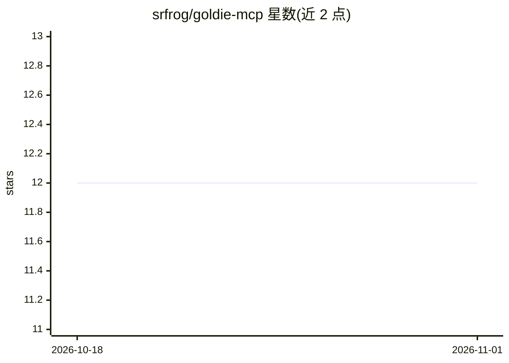

# srfrog/goldie-mcp

⭐ 12 · Go · MIT · 推送 2026-09-28 · [GitHub](https://github.com/srfrog/goldie-mcp) · [官网](http://srfrog.dev/goldie-mcp/) · 个人维护

**多 agent 共享记忆的本地 MCP 服务器，SQLite 向量索引**

用 Go 编写的本地运行 MCP 记忆服务器：将带类型（user/feedback/project 等 8 类）与唯一名称的记忆存入共享 SQLite 向量池，多个 agent（Claude Code、Claude Desktop、Codex）指向同一数据库即可共用 remember/recall/update_memory/forget 等工具，替代各项目独立的 MEMORY.md。召回提供语义 KNN 与 v4 新增的概念图召回，支持文件导入与异步任务队列。嵌入后端可选本地 MiniLM（ONNX Runtime）或 Ollama；同一作用域内无 agent 隔离，名称冲突即报错。

## 筛选速览

| 维度 | 判定 | 备注 |
|---|---|---|
| AI 角色 | `ai-ecosystem` | LLM/agent 周边工具 |
| 许可风险 | `permissive` | MIT |
| 部署形态 | `desktop` | 安装包/桌面程序 |
| 模型依赖 | local-ok | 支持本地模型 |
| 硬件要求 | — | 无带数字的原话,不猜 |
| 安装摩擦 | `medium` | 含编译或系统依赖之一 |
| 成熟度 | — | 结构信号不足 |

## 能力要点

- 8 种类型化记忆 + 唯一名称，多 agent 指向同一 SQLite 文件共享记忆池
- 语义 KNN 召回与 v4 概念图召回（concept_recall / automatic_recall）
- 双嵌入后端：MiniLM（本地 ONNX Runtime）或 Ollama（任意嵌入模型）
- index_file/index_directory 文件导入（SHA-256 校验门控）与异步任务队列

## 适用场景

- 让 Claude Code 与 Codex 共用一套跨项目记忆库
- 统一替代散落各项目的 MEMORY.md 文件
- 对本地文件目录建立可语义召回的 reference 记忆

## 场景标签

`Agent 记忆` · 领域:Agent 开发

## 证据(README 行号)

> L3: A multi-agent memory MCP server written in Go that runs locally on your machine. Goldie stores typed, named **memori
> L11: - **Multiple embedding backends**: MiniLM (local via ONNX Runtime) or Ollama (any embedding model)
> L133: claude mcp add -s user -e GOLDIE_DB_PATH=~/.local/share/goldie/index.db goldie /path/to/goldie-mcp

## 星数曲线

2026-10-18 12 → 2026-11-01 12（+0）

---
*卡片 v1 · prompt 1.4 · 生成 2026-11-01 · 置信度 high · 依据 README sha `fd8707512902` · [字段定义](../../DATASET.md)*
