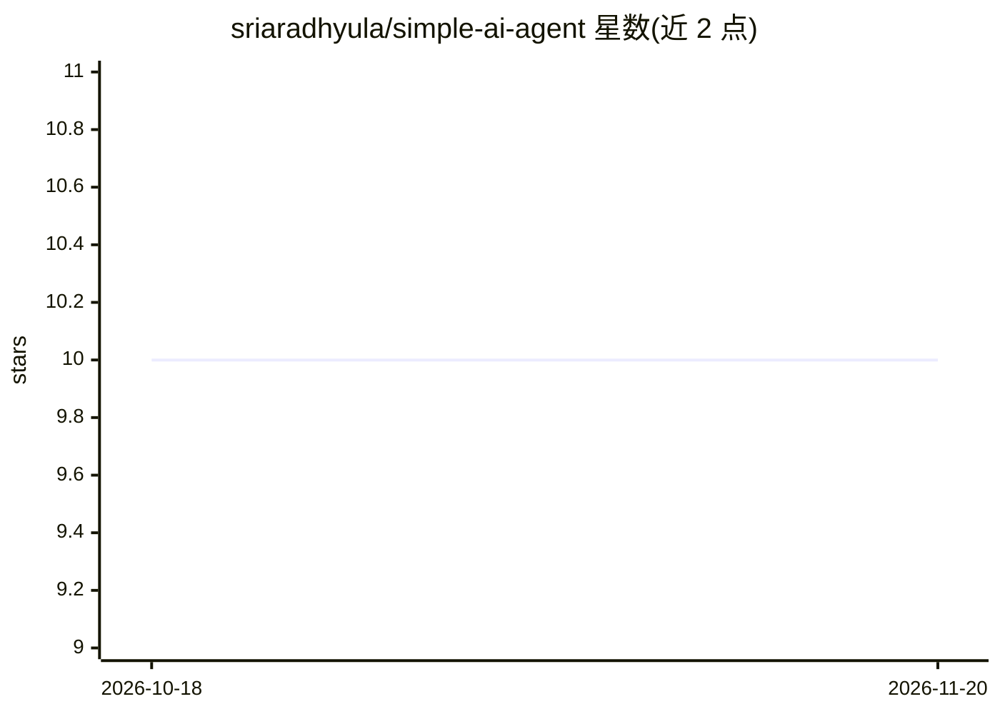

# sriaradhyula/simple-ai-agent

⭐ 10 · Jupyter Notebook · MIT · 推送 2026-04-07 · [GitHub](https://github.com/sriaradhyula/simple-ai-agent) · [官网](https://outshift.cisco.com/blog/build-react-agent-application-for-devops-tasks-using-rest-apis) · 个人维护

**教学示例：用 LangGraph 构建 ReAct agent 调用 GitHub API**

一个演示性仓库，展示如何用 LangGraph 定义工作流、构建执行工具调用的 ReAct agent。agent 以 HTTP 服务形式运行（Uvicorn，端口 8000），暴露 /question 端点；内置 get_github_repo_description 与 get_github_repo_topics 等工具，通过 REST API 读取 GitHub 仓库信息。README 给出单工具与多工具循环两个测试场景、Python 与 curl 客户端示例及思维链标注。作者声明代码仅用于教学目的，按 as-is 提供，不建议未经审查直接用于生产。

## 筛选速览

| 维度 | 判定 | 备注 |
|---|---|---|
| AI 角色 | `ai-native` | 本体是模型或模型工具 |
| 许可风险 | `permissive` | MIT |
| 部署形态 | `None` |  |
| 模型依赖 | — | README 未给出锁定关系 |
| 硬件要求 | — | 无带数字的原话,不猜 |
| 安装摩擦 | `low` | 无编译、无系统依赖或容器化 |
| 成熟度 | — | 结构信号不足 |

## 能力要点

- 使用 LangGraph 定义工作流的 ReAct agent
- 以 FastAPI/Uvicorn 服务形式运行，提供 /question HTTP 端点
- 演示单工具与多工具循环调用的思维链（HumanMessage/AIMessage/ToolMessage）
- 提供 Python requests 与 curl 两种客户端示例

## 适用场景

- 学习 ReAct agent 的构建方式与工具调用流程
- 了解 LangGraph 工作流的组织方法
- 作为调用 GitHub REST API 的 agent 示例起点

## 场景标签

`教程课程` · 领域:学习与行业

## 证据(README 行号)

> L3: This repo demonstrates building a simple ReAct AI agent to perform tasks such as retrieving GitHub repo details via 
> L21: INFO:     Uvicorn running on http://localhost:8000 (Press CTRL+C to quit)

## 星数曲线

2026-10-18 10 → 2026-11-20 10（+0）

---
*卡片 v1 · prompt 1.4 · 生成 2026-11-19 · 置信度 high · 依据 README sha `d7f8aab0026f` · [字段定义](../../DATASET.md)*
