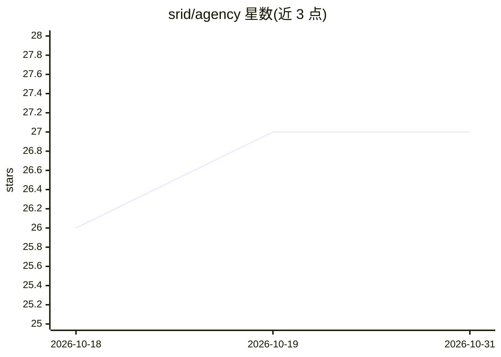

# srid/agency

⭐ 27 · Astro · MIT · 推送 2026-08-08 · [GitHub](https://github.com/srid/agency) · [官网](https://agency.srid.ca) · 个人维护

**面向编码 agent 的近自主工作流技能包（talk/do 双入口）**

以 APM 包形式分发的编码 agent 工作流技能集：`talk` 做只读的设计与代码探索，`do` 执行端到端交付（研究→实现→结构审查→质量门→CI→交付）。结构审查由 hickey（意外复杂度）与 lowy（基于波动性的分解）两个并行子 agent 承担，code-police 做三段式质量门，do-stop-guard 钩子阻止 agent 中途退出。主要在 Claude Code 与 Codex 上测试，支持 opencode；通过 apm 安装，项目配置放在 `.agency/` 目录的纯 Markdown 文件中。

## 筛选速览

| 维度 | 判定 | 备注 |
|---|---|---|
| AI 角色 | `ai-ecosystem` | LLM/agent 周边工具 |
| 许可风险 | `permissive` | MIT |
| 部署形态 | `None` |  |
| 模型依赖 | — | README 未给出锁定关系 |
| 硬件要求 | — | 无带数字的原话,不猜 |
| 安装摩擦 | `low` | 无编译、无系统依赖或容器化 |
| 成熟度 | — | 结构信号不足 |

## 能力要点

- talk/do 双入口：设计探索与端到端交付分离
- hickey/lowy 并行结构审查子 agent，发现项以同 PR 内提交落地
- code-police 三段式质量门在独立上下文运行以避免自我开脱
- ralph 度量驱动的迭代改进循环（性能/体积/复杂度）

## 适用场景

- 让编码 agent 按固定流水线自主完成从实现到 CI 的交付
- 在写代码前先做只读的设计讨论与方案收敛
- 对 LLM 生成的 diff 做结构性设计审查

## 场景标签

`编码 Agent` `代码审查` · 领域:编码与开发

## 证据(README 行号)

> L3: Agency[^agency] is a near-autonomous workflow for coding agents, packaged as an APM package. Two skills: **`talk`** 
> L6: > Agency has mainly been tested with Claude Code & Codex; opencode is supported but less battle-tested. YMMV with ot

## 星数曲线

2026-10-18 26 → 2026-10-31 27（+1）

---
*卡片 v1 · prompt 1.4 · 生成 2026-10-26 · 置信度 high · 依据 README sha `a2049786cc5d` · [字段定义](../../DATASET.md)*
