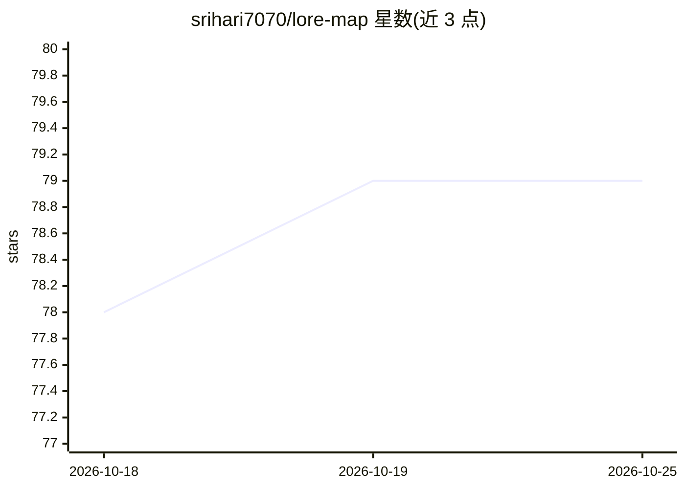

# srihari7070/lore-map

⭐ 79 · JavaScript · MIT · 推送 2026-06-21 · [GitHub](https://github.com/srihari7070/lore-map) · 个人维护

**把代码库变成可缩放架构图、编辑图后让 Claude 写代码的 CLI 工具**

面向开发者的 npm 全局安装 CLI：在任意项目内运行 lore deep-scan/scan/plan/sync，在浏览器打开 localhost:3333 展示可缩放架构树图，数据库块渲染为 ER 图，代码块展示文件、类/函数与 import 关系。图不仅可看还可编辑：改框、写注记、连线后交给 Claude 生成代码（直接 Build 或复制一行 prompt 到自己的 Claude Code 会话）。基于 Claude Agent SDK，用用户自己的 Claude 订阅或 ANTHROPIC_API_KEY 认证；解释器/构建器模型可用环境变量覆盖。限制：精确免费解析仅限 JS/TS 与 Prisma/SQL，其他语言由 Claude 采样阅读；本地服务无鉴权。

## 筛选速览

| 维度 | 判定 | 备注 |
|---|---|---|
| AI 角色 | `ai-ecosystem` | LLM/agent 周边工具 |
| 许可风险 | `permissive` | MIT |
| 部署形态 | `library` | 以包/库形式分发 |
| 模型依赖 | locked-api |  |
| 硬件要求 | — | 无带数字的原话,不猜 |
| 安装摩擦 | `low` | 无编译、无系统依赖或容器化 |
| 成熟度 | `idea` | |

## 能力要点

- 一条命令生成可缩放架构图，双击下钻到数据库表、文件与 import 关系
- 编辑地图后由 Claude 生成代码，或导出 prompt 交给自己的 Claude Code 会话
- 支持用户自己的 Claude 订阅认证，无需强制 API key
- 扫描为只读操作，代码仅在点击 Build 时变更

## 适用场景

- 接手陌生项目时快速看清整体架构与模块依赖
- 在图上做设计改动后让 Claude 按改动写代码
- 为 Claude Code 生成 CLAUDE.md 架构上下文，让后续构建直奔相关文件

## 场景标签

`编码 Agent` · 领域:编码与开发

## 证据(README 行号)

> L10: Then it flips: the map isn't just to *look* at — it's how you *change* the code. Edit a box, jot a note, connect tw
> L54: Lore uses the **Claude Agent SDK**, which authenticates two ways:
> L88: Node.js + Commander (CLI) · Express (local server) · React + Vite + React Flow + Tailwind (UI) · `@anthropic-ai/cla

## 星数曲线

2026-10-18 78 → 2026-10-25 79（+1）

---
*卡片 v1 · prompt 1.4 · 生成 2026-10-24 · 置信度 high · 依据 README sha `c955e94a26cc` · [字段定义](../../DATASET.md)*
