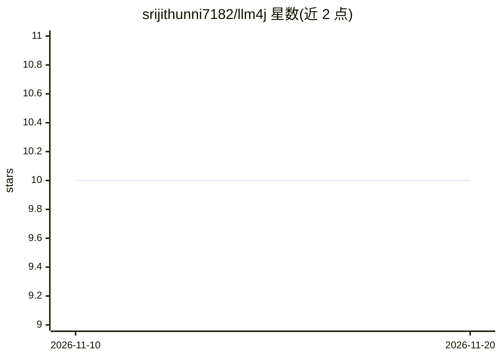

# srijithunni7182/llm4j

⭐ 10 · Java · Apache-2.0 · 推送 2026-11-18 · [GitHub](https://github.com/srijithunni7182/llm4j) · 个人维护

**Java 企业应用的 AI agent 构建与编排平台**

面向 JVM 企业应用的 agent 平台：核心库 ai-agent4j 以普通 Java 对象方式构建 ReAct agent（工具、记忆、RAG、每次模型调用前的预算检查）；Loom 工作流语言支持多 agent 编排，可离线执行 weave check/review/audit 进行架构审查并按 OWASP LLM Top 10 输出发现；eval4j 在 JUnit 中测试 agent；Inspect/Fabric 提供自托管运行观测。通过 Maven Central 发布，提供 Spring Boot starter，要求 Java 17+，Apache 2.0 许可。

## 筛选速览

| 维度 | 判定 | 备注 |
|---|---|---|
| AI 角色 | `ai-ecosystem` | LLM/agent 周边工具 |
| 许可风险 | `permissive` | Apache-2.0 |
| 部署形态 | `None` |  |
| 模型依赖 | local-ok | 支持本地模型 |
| 硬件要求 | — | 无带数字的原话,不猜 |
| 安装摩擦 | `medium` | 含编译或系统依赖之一 |
| 成熟度 | — | 结构信号不足 |

## 能力要点

- ai-agent4j 库以 Maven 单依赖提供 ReAct agent、工具、记忆、RAG 与预算控制
- Loom 工作流语言与 weave CLI：离线架构审查（check/review/audit），可接入 CI 门禁
- eval4j 在 JUnit 5 中支持无模型测试、黄金数据集与 LLM 评判
- 每步日志化的持久化工作流、审批、PII 掩码与审计事件

## 适用场景

- 在既有 Java 服务中嵌入 AI agent
- 构建需要审批、预算与审计的多 agent 工作流
- 在 CI 中对 agent 工作流做架构与安全检查
- 在 JUnit 中为 agent 编写回归测试

## 场景标签

`Agent 框架` `多智能体` `RAG` · 领域:Agent 开发

## 证据(README 行号)

> L5:  The agent platform for Java enterprise applications.
> L6:  Build, orchestrate, test and operate AI agents on the JVM, with a workflow language
> L36: **The names, in one line.** llm4j is the project. `ai-agent4j` is the library on Maven Central. Loom is the workflo

## 星数曲线

2026-11-10 10 → 2026-11-20 10（+0）

---
*卡片 v1 · prompt 1.4 · 生成 2026-11-19 · 置信度 high · 依据 README sha `d48d4776f208` · [字段定义](../../DATASET.md)*
