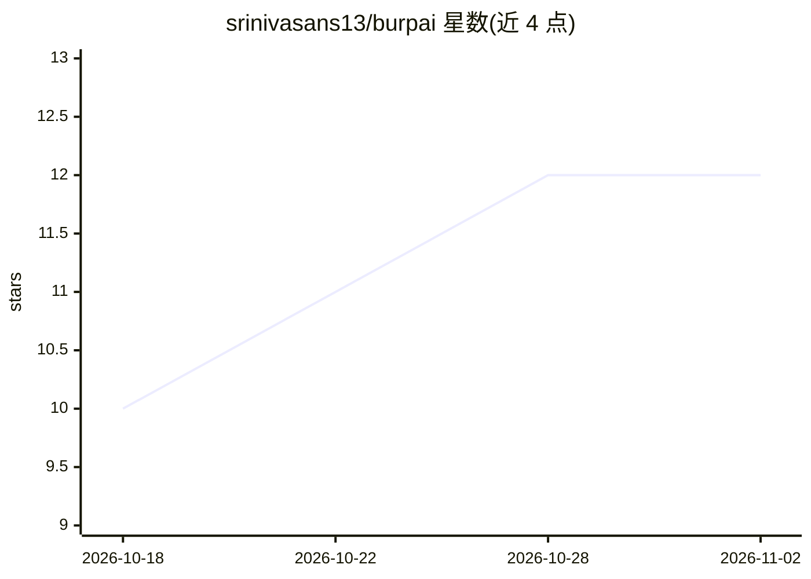

# srinivasans13/burpai

⭐ 12 · Java · MIT · 推送 2026-07-17 · [GitHub](https://github.com/srinivasans13/burpai) · 个人维护 · 中文 README

**Burp Suite 扩展：嵌入自主 AI 渗透测试 agent**

基于 Montoya API 的 Burp Suite 扩展，将自主渗透测试 agent 嵌入 Burp：agent 循环探测目标、经 Burp 引擎发出全部 HTTP 请求（可在 HTTP history 中实时查看），并通过 11 个工具完成爬取、fuzz、变量提取、解码与漏洞报告。支持 Ollama 本地及 Gemini/Claude/DeepSeek/OpenAI/OpenRouter 云端模型。支持 19 类漏洞的专注任务模式（含 LLM 提示注入）、基于响应时间的盲检测、向量记忆与 Repeater 内嵌 Copilot；产出 HTML/CSV 报告并回写 Burp Dashboard Issues。预编译 JAR 直接加载，构建源码需 Java 17+。

## 筛选速览

| 维度 | 判定 | 备注 |
|---|---|---|
| AI 角色 | `ai-native` | 本体是模型或模型工具 |
| 许可风险 | `permissive` | MIT |
| 部署形态 | `None` |  |
| 模型依赖 | local-ok | 支持本地模型 |
| 硬件要求 | — | 无带数字的原话,不猜 |
| 安装摩擦 | `medium` | 含编译或系统依赖之一 |
| 成熟度 | — | 结构信号不足 |

## 能力要点

- 自主 agent 循环，全部请求经 Burp 引擎发出并可在 HTTP history 查看
- 11 个 agent 工具（HTTP 请求、爬取、fuzz、提取、解码、站点地图查询、报告等）
- 19 类漏洞专注任务模式，含 LLM/提示注入测试
- 多 LLM 后端：Ollama 本地与 Gemini/Claude/DeepSeek/OpenAI/OpenRouter

## 适用场景

- 在 Burp 内用自然语言指派 agent 对授权目标做渗透测试
- 针对特定漏洞类别（如 SSRF、SQL 注入）做专注测试
- 在 Repeater 中获取 AI 建议的下一步测试请求

## 场景标签

`网络安全` · 领域:学习与行业

## 证据(README 行号)

> L5: A **Burp Suite extension** built on the Montoya API that embeds an autonomous AI penetration testing agent directly 
> L11: |**AI Pentester**|Autonomous agentic loop — probes targets, fires requests through Burp, confirms and reports vulne

## 星数曲线

2026-10-18 10 → 2026-11-02 12（+2）

---
*卡片 v1 · prompt 1.4 · 生成 2026-11-01 · 置信度 high · 依据 README sha `e59d91b95439` · [字段定义](../../DATASET.md)*
