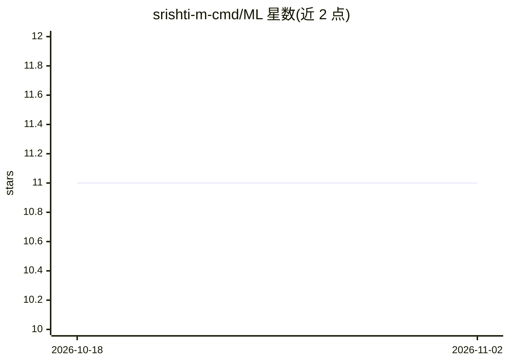

# srishti-m-cmd/ML

⭐ 11 · Python · 推送 2026-07-08 · [GitHub](https://github.com/srishti-m-cmd/ML) · 个人维护

**机器学习课程实验程序集：EDA、PCA、分类聚类等 Python 实现**

机器学习实验室课程的实验代码仓库，包含 10 个实验：探索性数据分析、相关性矩阵、PCA 降维、Find-S 算法、KNN、局部加权回归、线性/多项式回归、决策树、朴素贝叶斯与 K-Means 聚类，分别基于 California Housing、Iris、乳腺癌等公开数据集。以 Python 脚本组织，依赖 NumPy、Pandas、Matplotlib、Seaborn 与 Scikit-learn，通过 git clone 克隆后 pip 安装依赖并逐个运行。属课程作业性质的教学代码集合，非可复用的库或框架。

## 筛选速览

| 维度 | 判定 | 备注 |
|---|---|---|
| AI 角色 | `ai-knowledge` | 知识聚合/清单类 |
| 许可风险 | `none` | — |
| 部署形态 | `library` | 以包/库形式分发 |
| 模型依赖 | — | README 未给出锁定关系 |
| 硬件要求 | — | 无带数字的原话,不猜 |
| 安装摩擦 | `low` | 无编译、无系统依赖或容器化 |
| 成熟度 | — | 结构信号不足 |

## 能力要点

- 10 个实验覆盖监督学习、无监督学习与数据分析
- 使用 California Housing、Iris、Breast Cancer 等公开数据集
- 每个实验包含可视化输出（直方图、热力图、聚类图等）

## 适用场景

- 完成机器学习课程实验时参考实现
- 学习 EDA、PCA、KNN、决策树等经典算法的 Python 写法
- 了解常见公开数据集的分析流程

## 场景标签

`教程课程` · 领域:学习与行业

## 证据(README 行号)

> L3: This repository contains the implementation of various Machine Learning algorithms and data analysis techniques as p
> L64: ## 🛠️ Technologies Used

## 星数曲线

2026-10-18 11 → 2026-11-02 11（+0）

---
*卡片 v1 · prompt 1.4 · 生成 2026-11-01 · 置信度 mid · 依据 README sha `ad796696c9ed` · [字段定义](../../DATASET.md)*
