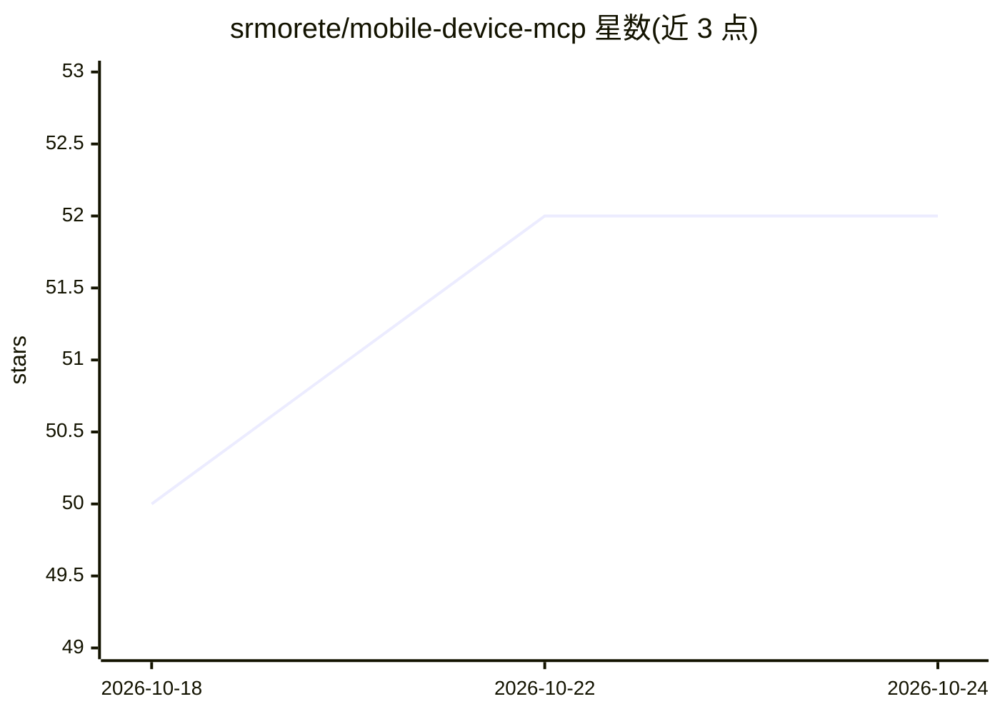

# srmorete/mobile-device-mcp

⭐ 52 · TypeScript · MIT · 推送 2026-08-02 · [GitHub](https://github.com/srmorete/mobile-device-mcp) · [官网](https://www.npmjs.com/package/@srmorete/mobile-device-mcp) · 个人维护

**让 AI agent 控制 iOS/Android 设备的 MCP 服务器，支持多设备并行**

面向 AI agent 的移动设备控制 MCP 服务器：通过运行在设备上的轻量 HTTP 服务（Android 用 UIAutomator、iOS 用 XCUITest）暴露无障碍树并接收交互指令，统一过滤为扁平元素列表后由 MCP 层代理请求。提供 13 个工具（截图、点击、输入、装应用等）及沙箱化 run_code 在设备上执行 JavaScript。前置依赖包括 Node.js 18+、Android SDK/adb，iOS 需 Xcode 相关工具链，真实设备还需 iproxy。

## 筛选速览

| 维度 | 判定 | 备注 |
|---|---|---|
| AI 角色 | `ai-ecosystem` | LLM/agent 周边工具 |
| 许可风险 | `permissive` | MIT |
| 部署形态 | `library` | 以包/库形式分发 |
| 模型依赖 | — | README 未给出锁定关系 |
| 硬件要求 | — | 无带数字的原话,不猜 |
| 安装摩擦 | `medium` | 含编译或系统依赖之一 |
| 成熟度 | — | 结构信号不足 |

## 能力要点

- iOS 与 Android 双平台统一 UI 树与 13 个交互工具
- 多设备并行，按序分配端口并以 bearer token 认证
- 沙箱化 run_code：Android 走 Rhino+UIAutomator 绑定，iOS 走 JavaScriptCore+XCUITest 绑定，自动终止死循环
- 首次使用时自动安装驱动应用并完成引导

## 适用场景

- 让 AI agent 自动化操作真机或模拟器做 UI 测试
- QA 场景下跨多台 Android/iOS 设备并行执行用例
- agent 通过统一元素树读取并操作混合 Native/WebView 界面

## 场景标签

`GUI 自动化` · 领域:效率与自动化

## 证据(README 行号)

> L3: An MCP server that lets AI agents control iOS and Android devices (tap, scroll, type, take screenshots, read UI tree
> L11: 3. **MCP server** — The external interface. Handles device discovery, bootstrapping, port allocation, and proxies r

## 星数曲线

2026-10-18 50 → 2026-10-24 52（+2）

---
*卡片 v1 · prompt 1.4 · 生成 2026-10-24 · 置信度 high · 依据 README sha `d55228de794a` · [字段定义](../../DATASET.md)*
