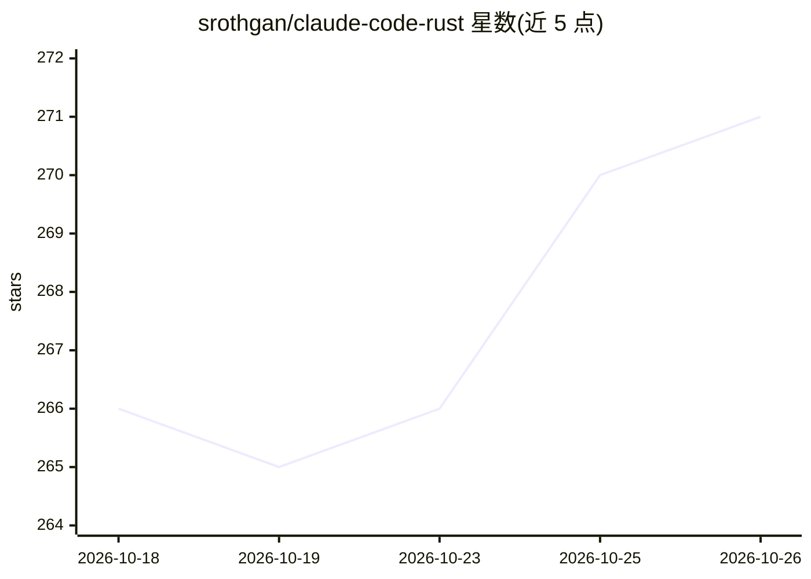

# srothgan/claude-code-rust

⭐ 271 · Rust · Apache-2.0 · 推送 2026-10-23 · [GitHub](https://github.com/srothgan/claude-code-rust) · [官网](https://srothgan.github.io/claude-code-rust/) · 个人维护

**Claude Code 的 Rust 原生终端界面替代前端**

用 Rust 编写的 Claude Code 终端 UI（claude-rs），基于 Ratatui 构建内联渲染：完成的消息与工具输出一次性写入终端滚动缓冲区，仅底部实时区域重绘，避免闪烁并保留终端原生搜索、tmux 复制与文本选择。通过 Anthropic 官方 Agent SDK 本地桥接运行会话，共享 Claude Code 的账号、模型、工具、权限、MCP 与会话历史。提供安装脚本与 npm 安装，npm 包附带预编译二进制与自带 Bun 运行时。项目处于 pre-1.0 阶段，部分功能仍需调用 claude CLI。

## 筛选速览

| 维度 | 判定 | 备注 |
|---|---|---|
| AI 角色 | `ai-ecosystem` | LLM/agent 周边工具 |
| 许可风险 | `permissive` | Apache-2.0 |
| 部署形态 | `library` | 以包/库形式分发 |
| 模型依赖 | locked-api |  |
| 硬件要求 | — | 无带数字的原话,不猜 |
| 安装摩擦 | `low` | 无编译、无系统依赖或容器化 |
| 成熟度 | `idea` | |

## 能力要点

- 基于 Ratatui 的内联渲染，会话保留在终端滚动缓冲区
- 通过 Anthropic 官方 Agent SDK 桥接，复用 Claude Code 账号/工具/权限/会话
- npm 包附带预编译平台二进制与自带 Bun 运行时，无需 Rust 工具链
- 会话工具：/resume 可搜索选择与分叉、/rewind、/compact、/export Markdown

## 适用场景

- 在 tmux、SSH 或分屏环境下使用 Claude Code 并保留原生搜索与复制
- 偏好键盘驱动、单一原生二进制的终端界面
- 导出会话为 Markdown 或回溯分叉历史会话

## 场景标签

`编码 Agent` · 领域:编码与开发

## 证据(README 行号)

> L3: An alternative terminal frontend for Claude Code, written in Rust. Your conversation stays in your terminal's own sc
> L12: Claude Code Rust (`claude-rs`) is a terminal UI for Claude Code built on Ratatui. It runs your sessions through Ant

## 星数曲线

2026-10-18 266 → 2026-10-26 271（+5）

---
*卡片 v1 · prompt 1.4 · 生成 2026-10-22 · 置信度 high · 依据 README sha `577f4aacfee0` · [字段定义](../../DATASET.md)*
