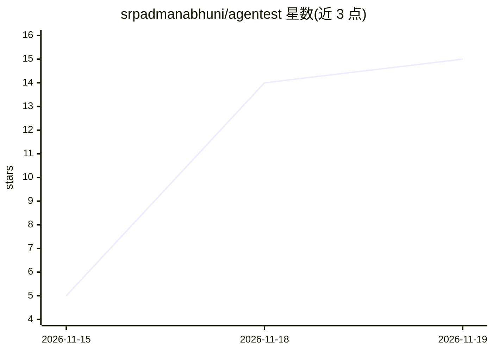

# srpadmanabhuni/agentest

⭐ — · [GitHub]() · 组织维护

**对 AI agent 已记录轨迹运行 130 项可执行测试的离线工具**

面向 agent 开发者与 QA 工程师：读取 agent 已记录的 OpenTelemetry GenAI 轨迹、A2A AgentCard 与 MCP 工具清单，运行 130 项确定性检查（8 大类，覆盖任务成功、依赖顺序、授权、提示注入、工具白名单、状态漂移、一致性等），输出 pass/fail/n/a 三态判定及证据行。无需账号、API key、网络或 LLM judge，同一轨迹结果可复现。支持 --strict 模式作 CI 门禁，输出 JUnit/SARIF/JSON/HTML/Markdown/CSV。原生导入 LangGraph、OpenAI Agents SDK、AutoGen、smolagents 和 n8n 日志；PyPI 包尚未发布，需从 GitHub 源码安装。限制：非认证，存在已知误报。

## 筛选速览

| 维度 | 判定 | 备注 |
|---|---|---|
| AI 角色 | `ai-ecosystem` | LLM/agent 周边工具 |
| 许可风险 | `permissive` | — |
| 部署形态 | `library` | 以包/库形式分发 |
| 模型依赖 | — | README 未给出锁定关系 |
| 硬件要求 | — | 无带数字的原话,不猜 |
| 安装摩擦 | `low` | 无编译、无系统依赖或容器化 |
| 成熟度 | — | 结构信号不足 |

## 能力要点

- 130 项可执行检查，判定基于工具调用与结果而非仅文本
- 确定性离线运行，无 LLM judge 与 API key，结果可复现
- 读取 OpenTelemetry GenAI / A2A / MCP 开放标准，无框架锁定
- --strict 退出码 1 可作 CI 门禁，多格式报告输出

## 适用场景

- 发布前对我的 agent 轨迹做确定性回归检查
- prompt 修改后跑回归测试确认行为未劣化
- 安全审查：捕捉提示注入、未授权操作与个人信息泄露
- 评估其他团队交付的 agent 是否名副其实

## 场景标签

`模型评测` · 领域:评测与运维

## 证据(README 行号)

> L3: > **Catches AI agents that say "done" when they did not do it.** agentest runs 130 executable checks on the traces y
> L48: - **QA and testers:** 130 ready-made executable checks with deterministic `pass` / `fail` / `n/a` verdicts and an e
> L54: - **Deterministic and offline:** no LLM judge, API key or network.

## 星数曲线

2026-11-15 5 → 2026-11-19 15（+10）

---
*卡片 v1 · prompt 1.4 · 生成 2026-11-18 · 置信度 mid · 依据 README sha `a104f8912177` · [字段定义](../../DATASET.md)*
