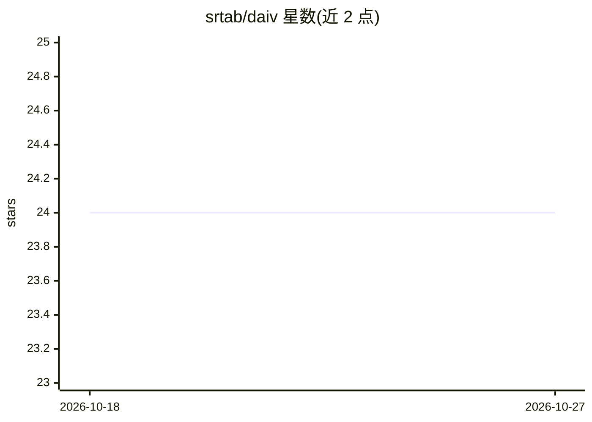

# srtab/daiv

⭐ 24 · Python · Apache-2.0 · 推送 2026-10-26 · [GitHub](https://github.com/srtab/daiv) · [官网](https://daivagent.com) · 组织维护

**自托管的 SWE AI agent，嵌入 Git 工作流自动修 issue 与 CI**

面向 GitLab/GitHub 用户的开源自托管 SWE agent 平台：通过 webhook 读取标记的 issue、提出计划、经批准后提交合并请求实现代码；还能回复 review 评论、修复失败的 CI/CD 管线，并支持斜杠命令。底层基于 LangGraph 构建的 Deep Agents 框架，附带子 agent、Docker 沙箱命令执行、MCP 工具与 LangSmith 监控。提供 MCP 端点接入编辑器、Jobs API 与可选自托管仪表盘（会话、定时任务、通知）。LLM 供应商可选 OpenRouter/Anthropic/OpenAI/Google，用户自带密钥。

## 筛选速览

| 维度 | 判定 | 备注 |
|---|---|---|
| AI 角色 | `ai-native` | 本体是模型或模型工具 |
| 许可风险 | `permissive` | Apache-2.0 |
| 部署形态 | `self-host` | docker 或自建部署 |
| 模型依赖 | locked-api |  |
| 硬件要求 | — | 无带数字的原话,不猜 |
| 安装摩擦 | `low` | 无编译、无系统依赖或容器化 |
| 成熟度 | — | 结构信号不足 |

## 能力要点

- 读取标记 issue → 计划 → 批准后开合并请求的实现流程
- 在合并/PR 线程内回复评论并修复失败的 CI/CD
- 基于 LangGraph 的 Deep Agents 框架，含子 agent 与 Docker 沙箱
- MCP 端点接入 Claude Code/Cursor/Codex CLI，Jobs API 供 CI 调用

## 适用场景

- 在 GitLab/GitHub 上让 agent 把 issue 直接变成合并请求
- 让 agent 在 PR 线程里回复评审意见并修复 CI 失败
- 从编辑器通过 MCP 或用 Jobs API 定时触发 agent 任务

## 场景标签

 · 领域:软件开发自动化/LLM 应用

## 证据(README 行号)

> L3:  Open-source, self-hosted SWE agents for GitLab &amp; GitHub
> L24: - **Issue Addressing** — DAIV reads a labelled issue, proposes a plan, and — once you approve — opens a merge/pull 
> L60: - **LLM Providers** — run on OpenRouter, Anthropic, OpenAI, or Google — your keys, your choice.

## 星数曲线

2026-10-18 24 → 2026-10-27 24（+0）

---
*卡片 v1 · prompt 1.4 · 生成 2026-10-27 · 置信度 high · 依据 README sha `6bfae1107e08` · [字段定义](../../DATASET.md)*
