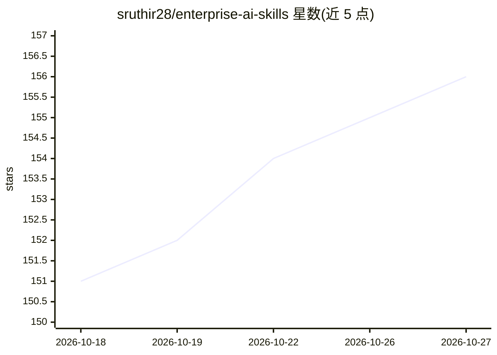

# sruthir28/enterprise-ai-skills

⭐ 156 · Python · MIT · 推送 2026-09-01 · [GitHub](https://github.com/sruthir28/enterprise-ai-skills) · 个人维护

**13 个麦肯锡式咨询框架打包成可加载的 Claude 技能库**

由前麦肯锡顾问整理的 13 个结构化提示技能，以 SKILL.md 形式供 Claude（或其他 LLM）加载：覆盖问题拆解（Issue Tree、Hypothesis Tree）、自上而下写作（Minto 金字塔）、决策备忘录、利益相关者地图，以及 4-agent Deck Pipeline 生成含原生可编辑图表的 .pptx。技能可组合使用，如 Issue Tree → Storyline → Charts → Deck Pipeline。作者声明不含微调，结构依赖 Claude 本体；deck 生成需 Python 3.9+ 与 python-pptx。

## 筛选速览

| 维度 | 判定 | 备注 |
|---|---|---|
| AI 角色 | `ai-knowledge` | 知识聚合/清单类 |
| 许可风险 | `permissive` | MIT |
| 部署形态 | `None` |  |
| 模型依赖 | locked-api |  |
| 硬件要求 | — | 无带数字的原话,不猜 |
| 安装摩擦 | `low` | 无编译、无系统依赖或容器化 |
| 成熟度 | — | 结构信号不足 |

## 能力要点

- 13 个编码具体咨询方法的技能（MECE 拆解、Day-1 假设、金字塔原则等）
- Deck Pipeline：Strategist→Builder→Critic→Fixer 四 agent 流水线，python-pptx 原生可编辑图表
- 技能可组合成常见工作流（客户调研→备忘录、董事会 deck 等）
- 支持 Claude Code 自动加载、Claude.ai 添加 .skill 文件或任意 LLM 复制上下文三种方式

## 适用场景

- 让 AI 把模糊的战略问题整理成决策备忘录或结构化 deck
- 为产品路线图决策做 RICE/影响力-工作量优先级评分
- 设计有产出物与责任人的对齐工作坊
- 在交付前用 McKinsey Critic 技能给文档与 deck 做质检

## 场景标签

`提示工程` `AI 写作` · 领域:Agent 开发

## 证据(README 行号)

> L3: **13 consulting frameworks from a former McKinsey consultant, packaged as drop-in Claude skills.** Issue trees, deci
> L104: **Is:** a library of 13 prompts-with-structure that turn a fuzzy strategic ask into a decision-shaped artifact. Ea
> L106: **Isn't:** a chatbot, a UI, or generic "AI for work" prompts. There's no model fine-tuning. The skills work becaus

## 星数曲线

2026-10-18 151 → 2026-10-27 156（+5）

---
*卡片 v1 · prompt 1.4 · 生成 2026-10-22 · 置信度 high · 依据 README sha `97708a473914` · [字段定义](../../DATASET.md)*
