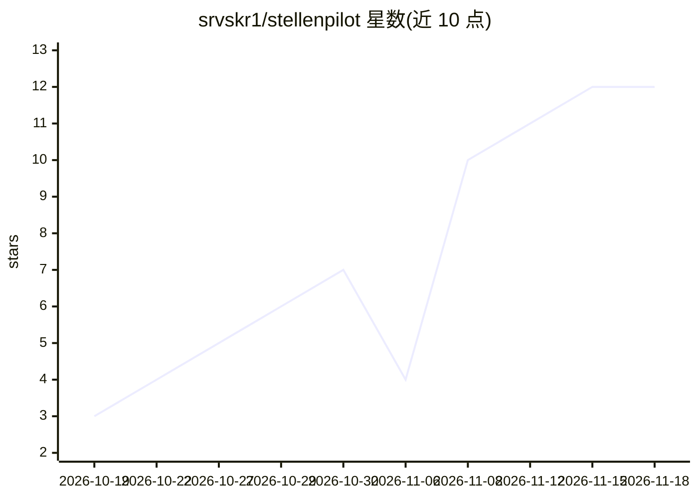

# srvskr1/stellenpilot

⭐ 12 · Python · MIT · 推送 2026-11-15 · [GitHub](https://github.com/srvskr1/stellenpilot) · [官网](https://stellenpilot.dev) · 个人维护

**德国求职者的本地求职助手：每日找岗、评分并生成求职信**

面向德国求职市场的本地应用：每日自动从 7 个招聘板和约 200 个公司官网采集新职位、去重，并将职位与用户简历比对给出 0-100 分及差距说明；对高分职位生成定制简历与求职信（Word/PDF），内置 truth guard 拒绝简历无依据的句子。内置 AI 在本地运行（基于 llama.cpp 与 Qwen3.5 模型），也可配置 Ollama 或 Claude/OpenAI；连接 Gmail 后可跟进申请回复，提供模拟面试与准备包。应用不代为投递或联系公司，支持英文与德文界面。

## 筛选速览

| 维度 | 判定 | 备注 |
|---|---|---|
| AI 角色 | `ai-native` | 本体是模型或模型工具 |
| 许可风险 | `permissive` | MIT |
| 部署形态 | `desktop` | 安装包/桌面程序 |
| 模型依赖 | local-ok | 支持本地模型 |
| 硬件要求 | — | 无带数字的原话,不猜 |
| 安装摩擦 | `low` | 无编译、无系统依赖或容器化 |
| 成熟度 | — | 结构信号不足 |

## 能力要点

- 每日自动采集 7 个招聘板与约 200 个公司官网职位并去重
- 简历-职位评分（0-100）附真实差距说明，truth guard 拦截无依据表述
- 内置本地 AI（llama.cpp + Qwen3.5）生成定制简历与求职信
- Gmail 连接跟进申请往来，附模拟面试与准备包

## 适用场景

- 在德国找技术或专业岗位，每天自动筛出新职位并按匹配度排序
- 为心仪职位生成与简历内容一致投简历和求职信
- 不想把简历上传云端，希望 AI 全程在本机运行
- 准备面试时用模拟面试和准备包练习

## 场景标签

`AI 助手` `网页抓取` `AI 写作` · 领域:效率与自动化

## 证据(README 行号)

> L3: **Every morning it finds new jobs, scores them against your CV and writes a tailored CV and cover letter for the bes
> L51: How it works: collect from 7 job boards and 200 company sites, score every job 0 to 100, write a CV and cover lette

## 星数曲线

2026-10-19 3 → 2026-11-18 12（+9）

---
*卡片 v1 · prompt 1.4 · 生成 2026-11-18 · 置信度 high · 依据 README sha `e55fad39d545` · [字段定义](../../DATASET.md)*
